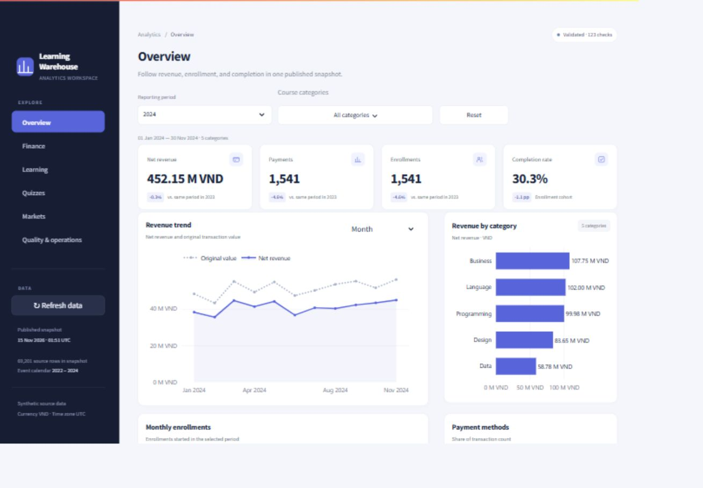
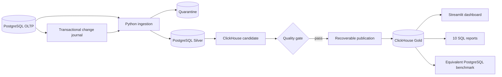
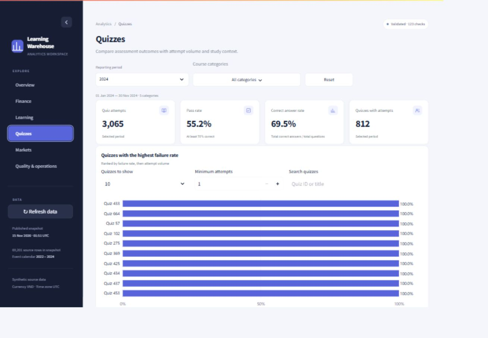

# Online Learning Warehouse

[](https://github.com/longieoo/online-learning-warehouse/actions/workflows/smoke.yml)

A PostgreSQL-to-ClickHouse warehouse for exploring course revenue, enrollments, learning activity and assessment results. It includes incremental ingestion, historical learner attribution, a fail-closed quality gate, recoverable publication, SQL reports and an English Streamlit dashboard.

The project runs locally with Docker and generates its own synthetic data. It is a runnable learning and portfolio project; it contains no real learner records.



## What you can explore

- Revenue before and after discounts and refunds, by month, category, instructor and payment method.
- Enrollment cohorts and completion rates, with explicit date and denominator definitions.
- Completed lessons, time spent and quiz attempts without confusing activity counts with distinct learners.
- Learner geography at the time of an event, including changes of address.
- Publication history, unresolved rejected records and quality results.

The analytical model is a Galaxy schema: **four fact tables and seven conformed dimensions**. Individual facts keep their own grain; combined reports aggregate separately before joining. [Architecture](docs/architecture.md) explains the model and its boundaries.



## Run locally

You need Docker with Linux containers and Docker Compose. Run commands from the repository root. The dashboard is available at [localhost:8501](http://localhost:8501).

```sh
docker compose up -d --wait postgres clickhouse
docker compose build runner dashboard
docker compose run --rm runner python cli.py all
docker compose --profile demo up -d --wait dashboard
```

The default generator creates **500,000 enrollments and 5,722,103 source rows** across 2022–2024. `all` initializes schemas and roles, generates only when the source is empty, runs a full load, exports reports and benchmarks both engines. It can take several minutes, depending on the host. Source generation is create-once; repeating `all` reuses populated source data.

For a smaller first run, choose the following command **instead of** the default `all`, on a fresh project:

```sh
docker compose run --rm -e DW_MIN_SOURCE_ROWS=0 runner python cli.py all --enrollments 5000 --runs 3
```

For subsequent pipeline runs on this small fixture, also set `DW_MIN_SOURCE_ROWS=0` in `.env`. The default five-million-row guard is intended for the full dataset and otherwise rejects a later small-fixture load.

Copy [.env.example](.env.example) to `.env` before creating volumes to customize ports, credentials or CPU/memory limits. Default passwords are local-demo credentials. Host ports bind only to loopback. See [security](SECURITY.md) before considering any network deployment.

## Update data and inspect results

```sh
# Optional: deliberately add synthetic changes to the source.
docker compose run --rm runner python -m demo.seed_incremental

# Process committed changes, including updates and deletes.
docker compose run --rm runner python cli.py pipeline --mode incremental
docker compose run --rm runner python cli.py doctor
docker compose run --rm runner python cli.py reports
```

Invalid new records are quarantined. Invalid updates retain the last clean version. Source transaction checkpoints and per-key revisions handle late commits and stale replay. A durable publication plan allows a retry to recover after interruption during table exchange.

An empty incremental run verifies Gold content before reuse. This detects same-count corruption; it also means an empty run does meaningful integrity work. PostgreSQL stores authoritative publication state, rather than relying on a leftover JSON file.

Reports are exported into `artifacts/reports/<export_id>/` with a complete-set manifest, row counts and SHA-256 hashes. Runtime outputs and database volumes stay outside Git.

## Dashboard

Six pages cover Overview, Finance, Learning, Quizzes, Markets, and Quality & operations. They include calendar/category filters, prior-period comparisons, readable rankings, quiz search and CSV downloads. Empty selections and unavailable denominators are displayed explicitly.

The latest-year preset ends at the last enrollment date in the source. Use **All time** or a custom interval to include later learning events. Completion rates describe the selected enrollment cohort at the current snapshot, not a historical daily progression. Amounts use integer VND; event times use UTC.

The operations page reads control state without running analytical queries. Browser-triggered pipeline execution is disabled by default; the CLI remains the normal operator entry point. CSV exports neutralize formula-like source text while preserving numeric values.



## Verify the complete workflow

```sh
python scripts/verify.py
```

The host command uses only Python's standard library plus Docker. It creates a **new isolated Compose project**, allocates free ports, starts from empty volumes and runs:

1. Source generation, full ETL and quality checks.
2. All ten reports and seven equivalent benchmark query pairs.
3. Offline and database-backed integration tests.
4. Late commits, schema drift, quarantine, deletes, quality failure and crash recovery scenarios.
5. Dedicated dashboard unit checks and live UI/Silver reconciliation.

The verifier refuses to reuse project resources, stops only its own services, and preserves its volumes and per-step logs. Deliberate failure scenarios require matching isolation markers. `scripts/verify.ps1` delegates to the same workflow on Windows.

For development, install the version-pinned dependencies in a virtual environment and run the strict offline gate:

```sh
python -m pip install -r requirements.lock.txt -r demo/requirements.lock.txt -r requirements-dev.txt
python scripts/check.py --fail-on-skip
```

CI separates lint/offline tests from the fresh-volume integration/recovery job and uploads evidence for failed as well as successful runs. [Verification records](docs/verification/README.md) distinguish current upgrade checks from the historical large-data experiment. A small smoke run is not a production load test.

## Benchmark fairly

```sh
docker compose run --rm runner python cli.py benchmark --runs 5 --warmups 2
```

The benchmark verifies serving data against its committed publication, copies the same eleven Gold tables to PostgreSQL, checks full-row SHA-256 and query-result multisets, then alternates which engine runs first. Raw samples, medians, spread, executed SQL and resource configuration are published as a complete immutable bundle. `artifacts/benchmark/latest.json` points to the latest successful set; `metadata.json` describes the latest attempt, including failure.

Storage comparison covers the same eleven tables and records auxiliary ClickHouse summaries separately. PostgreSQL includes indexes; ClickHouse active-part bytes include storage metadata. CPU quotas are shared-host limits. Engine RAM limits can differ, and neither query CPU nor query peak RAM is measured. See [benchmark methodology](docs/benchmark.md) for interpretation and equal-memory configuration.

## Repository guide

| Path | Contents |
|---|---|
| `oltp/` | Source schema, transactional journal and deterministic generator |
| `etl/` | Contracts, validation, Silver, incremental state, Gold publication and recovery |
| `dw/ddl/` | Gold schema, history mapping and aggregate feeds |
| `analytics/` | Ten analytical queries and complete CSV-set export |
| `benchmark/` | Equivalent SQL, parity, timing and coherent evidence publication |
| `demo/` | English dashboard, data access, charts and presentation |
| `tests/` | Offline, database, UI and destructive isolated regressions |
| `scripts/` | Strict checks and safe cross-platform verification |
| `docs/` | Architecture, mapping, dictionary, operations and dated evidence |

Start with the [runbook](docs/runbook.md), [source-to-target mapping](docs/mapping.md), [data dictionary](docs/data_dictionary.md) or [contribution guide](CONTRIBUTING.md).

## Scope and remaining limits

The calendar is fixed to 2022–2024 and Gold event timestamps have second precision. Long source transactions can delay incremental ingestion; journal retention is manual. Publication is atomic per table, with cooperative locks and recovery, not a distributed database transaction. External SQL readers must honor the publication boundary.

The local dashboard has no authentication and still shares the ClickHouse demo account with ETL. Its read-only UI is not database authorization. Backup restoration, multi-user production load, high availability and equal-resource engine qualification remain separate exercises. Historical timings are evidence for their dated runs, not performance guarantees for the upgraded implementation.
