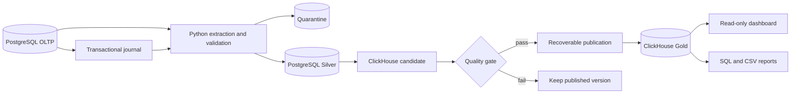
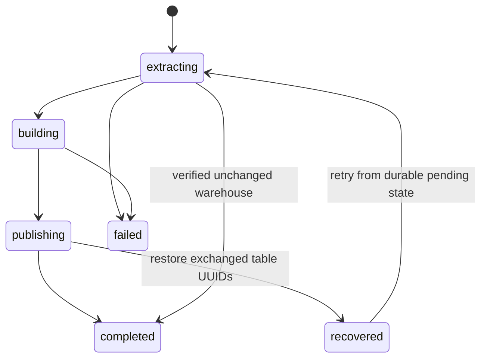

# Architecture

The warehouse turns synthetic online-learning transactions into historical, reconciled analytical data. It runs on one Docker host and deliberately uses a small stack: PostgreSQL, Python, ClickHouse and Streamlit.

## Data boundaries

| Layer | Location | Responsibility |
|---|---|---|
| Operational source | PostgreSQL `learning_oltp.oltp` | Business records, learner history and transactional change journal |
| Silver | PostgreSQL `dwh_staging.silver` | Validated current source rows, keyed by source identifiers |
| Quarantine | PostgreSQL `dwh_staging.quarantine` | Rejected payloads, reasons and resolution state |
| Control | PostgreSQL `dwh_staging.staging` | Transaction checkpoints, source revisions, pending changes, runs and publication plans |
| Candidate warehouse | ClickHouse `gold_build` | Build and validate a complete candidate before publication |
| Serving warehouse | ClickHouse `gold` | Four facts, seven dimensions, two summary tables and their view feeds |
| Temporary bridge | ClickHouse `stage_bridge` | PostgreSQL table engines reading Silver; removed after use |
| Comparison mirror | PostgreSQL `dwh_staging.benchmark` | Same Gold rows and columns for cross-engine parity and timing |

Source and staging are separate databases on the same PostgreSQL service. There is no extra ClickHouse Bronze copy. Original business data remains in OLTP and original change payloads are retained in the source journal or quarantine. The ETL source connection is read-only; initialization and synthetic fixture generation use a separate administrative connection.

## Four business processes and seven conformed dimensions

The model is a fact constellation, also called a Galaxy schema: four stars share consistent dimensions. Each fact retains its own grain.

| Fact | One row represents | Date role | User | Course | Instructor | Lesson | Quiz | Method |
|---|---|---|---|---|---|---|---|---|
| `fact_enrollments` | An enrollment, updated as progress changes | enrolled / completed | yes | yes | yes | | | |
| `fact_payments` | A payment transaction | paid | yes | yes | yes | | | yes |
| `fact_lesson_completions` | A completed lesson within an enrollment | completed | yes | yes | | yes | | |
| `fact_quiz_attempts` | An attempt at a quiz within an enrollment | attempted | yes | yes | | | yes | |

`dim_user` retains history with SCD Type 2. `dim_date` plays several date roles. Other dimensions retain the current master attributes (Type 1). Payment method, lesson and quiz are specialized dimensions; not every dimension belongs to every fact.

Drill-across reports aggregate each fact to a shared grain before joining. Joining payment rows directly to many lesson or quiz rows would multiply amounts. Count distinct people using natural `user_id`, not SCD version key `user_sk`.

Enrollment progress is a current accumulating snapshot. It does not reconstruct progress for every past day. Revenue is retained charged revenue after full-refund flags, attributed to the original payment date; there is no separate refund-date event. Values use integer VND and UTC. The generated calendar covers 2022–2024, and Gold event times have second precision.

## Full and incremental ingestion

Full extraction uses a PostgreSQL `REPEATABLE READ` snapshot and batches of at most 50,000 rows. Silver, source-version records and the pending-change state commit together. A durable `needs_full` flag prevents a failed full build from being mistaken for a completed baseline during an incremental retry.

Incremental extraction reads `oltp.change_journal`. Source triggers record the transaction ID, revision, operation and payload in the same transaction as the business change. The ETL processes transaction IDs below the snapshot's safe boundary. This prevents an earlier open transaction from being skipped when a later transaction commits first. A long-running source transaction can delay later committed changes; completeness takes priority over advancing an unsafe checkpoint.

Per-key revision state rejects older journal updates. Pending changes survive a committed Silver transaction followed by a failed Gold build. Deletes produce durable tombstone state so replaying an older update cannot resurrect a removed record.

Invalid new records are quarantined and excluded from Silver. Invalid updates retain the last known clean row. A valid correction resolves the rejection; deletion of an invalid source record also resolves its open rejection.

Additive source columns outside the explicit contract are ignored. Missing required columns or incompatible types stop extraction before publication. Schema evolution is intentional: update the contract and mapping for meaningful changes, then rebuild.

## Rebuild and reuse decisions

Dimensions are rebuilt when a candidate is needed. New append-only event rows can reuse existing fact partitions and insert only the delta. Updates/deletes of older events rebuild the affected fact. A changed dimension or history mapping can require rebuilding facts. Enrollment revisions are consolidated before serving; changes across enrollment-month partitions force the required rebuild.

Incremental reuse checks table UUIDs and all-column content fingerprints against the committed publication. A same-row-count mutation therefore cannot silently pass as an intact warehouse. If integrity is lost, the affected build restores data from Silver. A mandatory full rebuild skips scanning the old Gold unnecessarily. These checks add real work to an empty incremental run; historical no-op timings from earlier versions are not promises for the upgraded code.

## Historical learner attribution

Source `user_history` contains half-open intervals `[valid_from, valid_to)` with `2100-01-01` as the current-version sentinel. Each event selects the learner version whose start is the nearest one not after the event, using `ASOF JOIN`; validation also checks that the event precedes the interval end.

An activity exactly at the new version's start belongs to the new version. Enrollment uses enrollment time even when completion occurs after a move; payment, lesson and quiz events use their respective event times. The gate checks a single current version, interval ordering and coverage. The warehouse cannot invent history absent from the source.

## Publication and recovery

Before exchanging the first table, PostgreSQL stores the candidate and previous UUID for every table. If a process stops during publication, the next pipeline compares actual UUIDs with this plan and restores tables already exchanged. Unknown UUIDs cause a stop for investigation, rather than speculative deletion of candidate data. Aggregate view feeds are dropped before exchanging their target tables and recreated afterward.

Only after all exchanges and feeds succeed does one PostgreSQL transaction commit the publication manifest/checkpoint and consume pending changes. JSON files are readable exports; PostgreSQL publication state is authoritative. A stale `pipeline.json` cannot make a newly created database ready.

`EXCHANGE TABLES` is atomic for one table, not for the complete multi-database operation. Project writers acquire an exclusive PostgreSQL advisory lock; reports and dashboard snapshots acquire a shared lock. Connections are retained for the entire protected operation and closed on failures. External SQL clients must honor the same lock or avoid the publication window.

## Access and deployment scope

`learning_reader` can only read the source. `learning_stage` writes staging/control/benchmark data and cannot connect to OLTP. Dashboard configuration does not contain the PostgreSQL administrative password. Dashboard pipeline execution is disabled by default; explicitly setting `DW_DASHBOARD_ALLOW_PIPELINE=1` enables the local operator action.

All host ports bind to loopback. Memory limits are configurable and recorded in benchmark metadata. CPU limits are quotas on a shared host. Application containers use an init process and prohibit privilege escalation.

The ClickHouse account is shared between ETL and dashboard in this local demo. Read-only UI controls are not database authorization. There is no application authentication, distributed HA, tested backup restoration or production load qualification. Put authentication and separate least-privilege database roles in place before considering a network deployment. See [security](../SECURITY.md) and [operations](operations.md).
