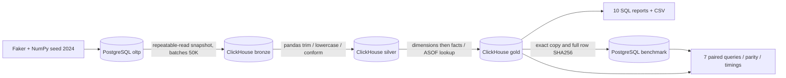
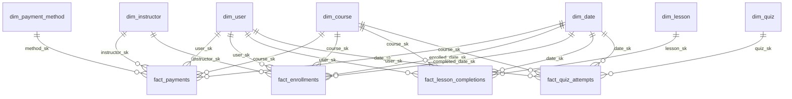

# Kiến trúc và thiết kế

## Mục tiêu và tiêu chí nghiệm thu

Trả lời doanh thu theo thời gian/danh mục/giảng viên/phương thức, ghi danh và hoàn thành, thời gian học, kết quả quiz. Tiêu chí: nguồn ≥5M dòng; sự kiện 2022–2024; đủ 4 fact + 6 dim; SCD2, role-playing, degenerate, conformed; pipeline có đối soát; ≥5 benchmark queries có kết quả thực và equality.

## Grain và bus matrix

| Fact | Grain / khóa nghiệp vụ | Date | User | Course | Instructor | Lesson | Quiz | Method |
|---|---|---|---|---|---|---|---|---|
| fact_enrollments | 1 enrollment_id; trạng thái cuối kỳ 2024 | enrolled + completed | ✓ | ✓ | ✓ | | | |
| fact_payments | 1 payment_id, transaction_id duy nhất | paid | ✓ | ✓ | ✓ | | | ✓ |
| fact_lesson_completions | 1 enrollment + lesson hoàn thành | completed | ✓ | ✓ | | ✓ | | |
| fact_quiz_attempts | 1 enrollment + quiz + attempt_number | attempted | ✓ | ✓ | | | ✓ | |

Enrollment là accumulating snapshot với hai mốc ngày. Không có snapshot mỗi ngày nên không suy ra tiến độ lịch sử theo ngày từ trạng thái cuối kỳ. Payment, lesson, quiz là transaction facts.

## Kỹ thuật chiều

- **SCD Type 2:** 50.000 user và 60.000 phiên bản lịch sử. 10.000 user đổi city từ 2023-07-01. `valid_from <= event_time < valid_to`; sentinel 2100-01-01 cho phiên bản hiện tại. ASOF chọn phiên bản mới nhất có valid_from ≤ thời điểm; quality gate kiểm tra valid_to để không nhận khoảng trống lịch sử. Test riêng giây trước, đúng lúc và giây sau ranh giới.
- **Surrogate keys:** user_sk = source history_id + 10.000.000, mỗi phiên bản khác nhau; các dimension Type 1 có ánh xạ số nguyên riêng ổn định trong dataset này. Đây là ánh xạ xác định trong namespace từng bảng, không phải dịch vụ cấp khóa đa nguồn tổng quát. Fact phải JOIN dimension để lookup, không chỉ tính công thức trên fact.
- **Role playing:** dim_date dùng hai lần trong enrollment. completed_date_sk=0 khi chưa hoàn thành; dòng unknown có full_date=1970-01-01 và các level bằng 0, không phải ngày nghiệp vụ.
- **Degenerate:** transaction_id ở fact_payments; enrollment_id ở các fact học tập hỗ trợ drill-through, không tạo dimension invoice giả.
- **Conformed:** date, user, course dùng cùng định nghĩa và cùng key trên mọi fact. user_sk có thể khác giữa hai sự kiện của cùng user nếu xảy ra hai phía ranh giới SCD2; distinct learner phải dùng user_id từ dim_user.
- Geography phi chuẩn hóa trong user; category/difficulty trong course để giữ mô hình star. Week không được đặt giữa day và month vì tuần có thể băng qua tháng; hierarchy chính day → month → quarter → year.

## Measures và phép tổng hợp

Tiền VND integer (không Float). original_vnd - discount_vnd = charged_vnd; net_vnd = charged_vnd × (1 - refunded). Tất cả thanh toán thành công, một phần bị refund toàn phần; giao dịch khóa miễn phí có giá 0. Không có currency conversion hay payment failure.

Số giây, số câu đúng/tổng câu, tiền và event count là additive ở grain phù hợp. Completion rate = SUM(is_completed)/COUNT(enrollment), pass rate = SUM(is_passed)/COUNT(attempt), điểm quiz = 100×SUM(correct_count)/SUM(total_questions). Không cộng các tỷ lệ hoặc lấy trung bình của các trung bình không trọng số. Distinct learner là non-additive; không cộng distinct giữa nhóm.

Drill-across tổng hợp mỗi fact về cùng course/date trước khi nối. Lấy union bộ khóa hai phía để không mất ngày chỉ có payment hoặc enrollment (paid_at chậm hơn enrolled_at 60 giây có thể qua ngày).

## Physical và ETL

- PostgreSQL: PK, FK, unique, check; COPY trong một transaction, ANALYZE sau load.
- Bronze: 1:1 nguồn, `_run_id`, `_loaded_at` UTC, `_source`; giữ nguyên email bẩn để audit. Đây là snapshot gần nhất, không phải lịch sử append-only vĩnh viễn.
- Silver: thực sự đọc từ Bronze, dùng pandas trim/lowercase/upper country; không silently drop invalid rows. Nguồn PK đã ngăn duplicate; quality gate phát hiện duplicate/orphan thay vì dùng merge bất đồng bộ làm dedup.
- Gold: ClickHouse MergeTree, fact partition tháng, sort date/course/user/event; dimension LowCardinality cho thuộc tính lặp. Không cần FINAL vì không dùng ReplacingMergeTree.
- Full rebuild, không incremental/CDC. Từng run lưu manifest và quality gate; PostgreSQL advisory lock bảo vệ các CLI command. Stream đọc Bronze dùng client riêng với client insert để tránh khóa session.
- Giới hạn bộ nhớ truy vấn ClickHouse 1,8 GB, 4 threads, spill group/sort ở 500 MB; container PG 2 GB, CH 3 GB, runner 1500 MB.
- Không materialized aggregate vì workload hiện tại đủ nhỏ; benchmark không được hưởng shortcut khác giữa hai DB.

## Giới hạn và failure modes

Không có atomic publish toàn bộ database. Khi rebuild, CLI consumer đợi success manifest, còn external SQL reader phải tuân thủ maintenance window. Mất tiến trình có thể để manifest running; rerun pipeline khôi phục. Nếu nguồn đã commit nhưng artifact generation chưa ghi do mất điện, không generate lại; kiểm tra count nguồn rồi chạy pipeline.

Nếu nguồn schema thay đổi, CREATE IF NOT EXISTS không tự migrate bảng cũ; triển khai migration có kiểm soát trước khi chạy. Không hỗ trợ deletes/late events incrementally. Manifest trên host phải đi cùng volumes; sửa DB ngoài CLI làm mất giá trị bằng chứng kiểm tra, cần validate và rebuild artifacts.

Thiết kế không cung cấp production HA, replication, back-up tự động, TLS hay quyền read-only BI riêng. Đây là môi trường học tập localhost với dữ liệu giả.

## Tham khảo kỹ thuật

- [ClickHouse ASOF JOIN](https://clickhouse.com/blog/clickhouse-fully-supports-joins-part1): lookup nearest earlier effective time, kết hợp quality check nửa mở.
- [ClickHouse Docker entrypoint](https://github.com/ClickHouse/ClickHouse/blob/master/docker/server/entrypoint.sh): cấu hình user/password qua environment.
- Tài liệu bài tập nguyên bản: `../plan.md`, `../quy_trinh_tao_data_warehouse.md`, `../tong_hop_thuat_ngu.md`. Các tài liệu thuật ngữ có ký hiệu trích dẫn chưa resolve; không coi đó là bằng chứng kiểm chứng runtime.
