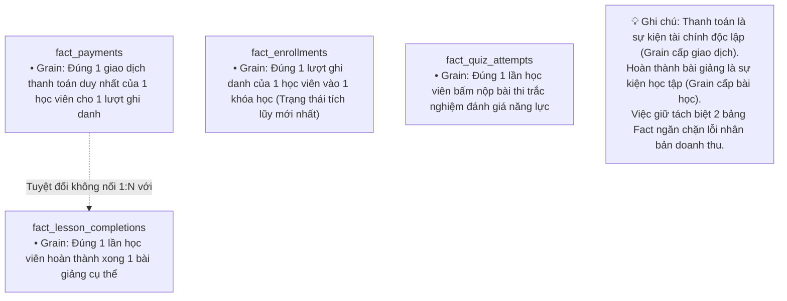
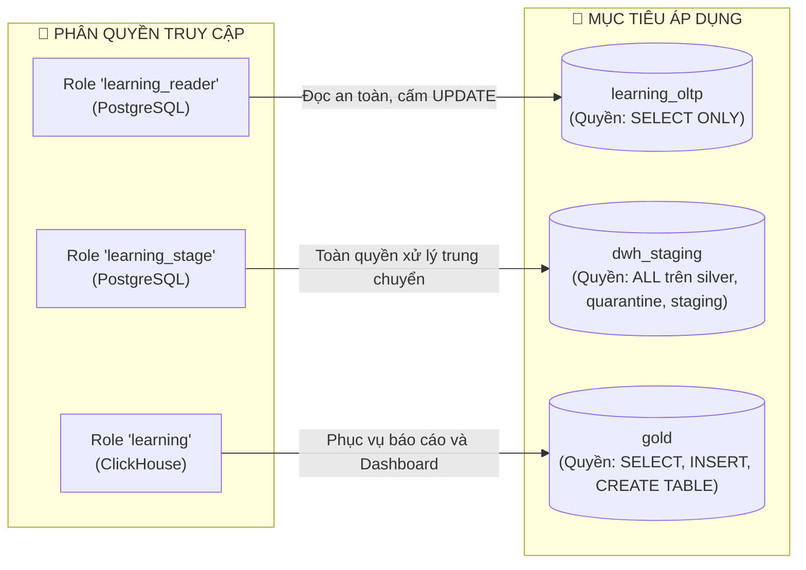

# 📚 TỪ ĐIỂN DỮ LIỆU & DANH MỤC TÀI SẢN THÔNG TIN (DATA CATALOG)
## Online Learning Data Warehouse (Enterprise Data Asset & Business Dictionary)

> **Tóm tắt định hướng:**  
> Tài liệu này đóng vai trò là Danh mục Tài sản Dữ liệu (Data Catalog) và Từ điển Nghiệp vụ (Business Glossary) chính thức của Kho dữ liệu Học trực tuyến. Tài liệu định nghĩa tường minh từng thuật ngữ kinh doanh, độ mịn dữ liệu (Grain), cấu trúc bảng, kiểu dữ liệu, các độ đo (Measures), các chiều phân tích (Dimensions) và vai trò quản trị truy cập.

---

## 📑 MỤC LỤC
1. [Từ Điển Thuật Ngữ Nghiệp Vụ (Business Glossary)](#1-từ-điển-thuật-ngữ-nghiệp-vụ-business-glossary)
2. [Độ Mịn Dữ Liệu (Data Granularity / Grain Definition)](#2-độ-mịn-dữ-liệu-data-granularity--grain-definition)
3. [Danh Mục 7 Bảng Chiều (Dimension Tables Catalog)](#3-danh-mục-7-bảng-chiều-dimension-tables-catalog)
4. [Danh Mục 4 Bảng Sự Kiện (Fact Tables Catalog)](#4-danh-mục-4-bảng-sự-kiện-fact-tables-catalog)
5. [Danh Mục Bảng Tổng Hợp & Khu Vực Cách Ly (Summary Views & Staging)](#5-danh-mục-bảng-tổng-hợp--khu-vực-cách-ly-summary-views--staging)
6. [Chính Sách Sở Hữu & Phân Quyền Truy Cập (Data Ownership & Roles)](#6-chính-sách-sở-hữu--phân-quyền-truy-cập-data-ownership--roles)

---

## 1. Từ Điển Thuật Ngữ Nghiệp Vụ (Business Glossary)

Để đảm bảo toàn bộ các bộ phận (Ban Giám đốc, Kế toán, Giảng viên, Vận hành, Kỹ thuật) hiểu đúng và thống nhất về các chỉ số phân tích:

| Thuật ngữ | Tên tiếng Anh | Công thức / Định nghĩa chuẩn | Mục đích sử dụng |
| :--- | :--- | :--- | :--- |
| **Giá trị Giao dịch Gộp** | Gross Merchandise Value (GMV) | $\sum (\text{original\_vnd})$ | Đo lường tổng giá trị danh nghĩa của tất cả các khóa học được đặt mua trước khi áp dụng khuyến mãi. |
| **Tiền Giảm Giá** | Total Discount | $\sum (\text{discount\_vnd})$ | Tổng số tiền nền tảng đã chiết khấu hoặc ưu đãi cho học viên. |
| **Tiền Thực Thu** | Charged Amount | $\sum (\text{charged\_vnd}) = \text{GMV} - \text{Discount}$ | Số tiền thực tế chuyển qua cổng thanh toán / ngân hàng vào tài khoản công ty. |
| **Doanh Thu Thuần** | Net Revenue | $\sum (\text{charged\_vnd} \times (1 - \text{refunded}))$ | **Doanh thu thực tế của doanh nghiệp** sau khi đã trừ đi các giao dịch hoàn tiền. |
| **Tỷ Lệ Hoàn Tiền** | Refund Rate (%) | $\frac{\text{Số giao dịch hoàn tiền}}{\text{Tổng số giao dịch thanh toán}} \times 100\%$ | Đánh giá mức độ hài lòng của học viên và chất lượng khóa học. |
| **Tỷ Lệ Giảm Giá** | Discount Erosion (%) | $\frac{\text{Tiền giảm giá}}{\text{GMV}} \times 100\%$ | Giám sát mức độ hao mòn biên lợi nhuận do các chiến dịch khuyến mại. |
| **Tỷ Lệ Bắt Đầu Học** | Activation Rate (%) | $\frac{\text{Số học viên hoàn thành } \ge 1 \text{ bài}}{\text{Tổng số học viên ghi danh}} \times 100\%$ | Đo lường tỷ lệ học viên thực sự kích hoạt việc học sau khi mua khóa. |
| **Tỷ Lệ Hoàn Thành** | Course Completion Rate (%) | $\frac{\text{Số học viên hoàn thành đủ 10 bài}}{\text{Tổng số học viên ghi danh}} \times 100\%$ | Đánh giá tỷ lệ học viên đi đến đích cuối cùng và tốt nghiệp. |
| **Tỷ Lệ Trượt Đề Thi** | Quiz Fail Rate (%) | $\frac{\text{Số lượt thi có điểm } < 70\%}{\text{Tổng số lượt thi}} \times 100\%$ | Phát hiện các đề thi quá khó hoặc câu hỏi đánh đố cần điều chỉnh. |

---

## 2. Độ Mịn Dữ Liệu (Data Granularity / Grain Definition)

Độ mịn (Grain) là định nghĩa một dòng trong bảng đại diện cho sự vật, hiện tượng gì trong đời thực. Xác định đúng Grain là điều kiện tiên quyết để chống lỗi đếm trùng trong Kho dữ liệu:

---

## 3. Danh Mục 7 Bảng Chiều (Dimension Tables Catalog)

### 3.1 `gold.dim_date` (Chiều Thời Gian)
* **Độ mịn (Grain):** Mỗi dòng đại diện cho một ngày dương lịch.
* **Quy mô:** 1.097 dòng (Gồm 1.096 ngày từ 2022-01-01 đến 2024-12-31, có ngày nhuận 2024-02-29, và 1 dòng `date_sk = 0` dành cho Unknown Date).
* **Đặc tả cột:**

| Tên cột | Kiểu dữ liệu | Vai trò | Mô tả ý nghĩa nghiệp vụ |
| :--- | :--- | :---: | :--- |
| `date_sk` | Int64 | Khóa chính (PK) | Định dạng số nguyên YYYYMMDD (ví dụ: `20230701`). Giá trị `0` đại diện ngày chưa xác định. |
| `full_date` | Date | Thuộc tính | Ngày lịch chuẩn định dạng YYYY-MM-DD. |
| `year` | Int64 | Phân cấp | Năm dương lịch (2022, 2023, 2024). |
| `quarter` | Int64 | Phân cấp | Quý trong năm (1, 2, 3, 4). |
| `month` | Int64 | Phân cấp | Tháng trong năm (1 đến 12). |
| `day` | Int64 | Phân cấp | Ngày trong tháng (1 đến 31). |

---

### 3.2 `gold.dim_user` (Chiều Học Viên - Quản Lý SCD Type 2)
* **Độ mịn (Grain):** Mỗi dòng đại diện cho một phiên bản thông tin cư trú của một học viên.
* **Quy mô:** 60.000 dòng (50.000 học viên, trong đó 10.000 học viên có lịch sử chuyển nhà từ tháng 07/2023).
* **Đặc tả cột:**

| Tên cột | Kiểu dữ liệu | Vai trò | Mô tả ý nghĩa nghiệp vụ |
| :--- | :--- | :---: | :--- |
| `user_sk` | Int64 | Khóa chính (PK) | Khóa thay thế phân dải: `history_id + 10000000`. |
| `user_id` | Int64 | Khóa tự nhiên | Mã định danh học viên ở hệ thống tác nghiệp nguồn. |
| `full_name` | String | Thuộc tính | Họ và tên đầy đủ của học viên. |
| `email` | String | Thuộc tính | Email học viên (đã chuẩn hóa chữ thường và cắt khoảng trắng). |
| `city` | LowCardinality(String) | Thuộc tính SCD2 | Thành phố cư trú (Ha Noi, Da Nang, Ho Chi Minh, Can Tho). |
| `country` | LowCardinality(String) | Thuộc tính | Quốc gia cư trú (chuẩn hóa 2 ký tự: `VN`). |
| `valid_from`| DateTime('UTC') | Ranh giới SCD2 | Mốc thời gian bắt đầu có hiệu lực của phiên bản địa chỉ. |
| `valid_to` | DateTime('UTC') | Ranh giới SCD2 | Mốc thời gian hết hiệu lực (`2100-01-01` đối với bản ghi hiện hành). |
| `is_current`| Int64 | Cờ hiệu | `1` nếu là địa chỉ hiện tại, `0` nếu là địa chỉ lịch sử cũ. |

---

### 3.3 `gold.dim_course` (Chiều Khóa Học)
* **Độ mịn (Grain):** Mỗi dòng đại diện cho một khóa học duy nhất trên hệ thống.
* **Quy mô:** 1.000 dòng.
* **Đặc tả cột:**

| Tên cột | Kiểu dữ liệu | Vai trò | Mô tả ý nghĩa nghiệp vụ |
| :--- | :--- | :---: | :--- |
| `course_sk` | Int64 | Khóa chính (PK) | Khóa thay thế phân dải: `course_id + 1000000`. |
| `course_id` | Int64 | Khóa tự nhiên | Mã khóa học ở hệ thống tác nghiệp nguồn. |
| `title` | String | Thuộc tính | Tiêu đề tên khóa học. |
| `category` | LowCardinality(String) | Thuộc tính | Danh mục: Data, Programming, Business, Design, Language. |
| `difficulty`| LowCardinality(String) | Thuộc tính | Cấp độ: beginner, intermediate, advanced. |
| `instructor_id`| Int64 | Khóa ngoại | Mã giảng viên phụ trách khóa học. |
| `price_vnd` | Int64 | Độ đo chiều | Giá niêm yết của khóa học (VND). |

---

### 3.4 Các Bảng Chiều Còn Lại
* **`gold.dim_instructor` (Giảng viên):** `instructor_sk` (PK, id + 2M), `instructor_id`, `full_name`, `expertise`. (100 dòng).
* **`gold.dim_lesson` (Bài giảng):** `lesson_sk` (PK, id + 3M), `lesson_id`, `course_id`, `title`, `position` (thứ tự bài 1..10). (10.000 dòng).
* **`gold.dim_quiz` (Đề thi trắc nghiệm):** `quiz_sk` (PK, id + 4M), `quiz_id`, `course_id`, `title`, `total_questions` (20 câu). (1.000 dòng).
* **`gold.dim_payment_method` (Phương thức thanh toán):** `method_sk` (PK, id + 5M), `method_id`, `method_name` (bank_transfer, card, wallet). (3 dòng).

---

## 4. Danh Mục 4 Bảng Sự Kiện (Fact Tables Catalog)

### 4.1 `gold.fact_payments` (Sự Kiện Thanh Toán - Transaction Fact)
* **Loại Fact:** Transaction Fact (Append-only).
* **Độ mịn (Grain):** Đúng 1 giao dịch thanh toán thành công hoặc hoàn tiền.
* **Quy mô:** 500.000 dòng. Phân hoạch theo tháng: `PARTITION BY toYYYYMM(paid_at)`.
* **Đặc tả cột:**

| Tên cột | Kiểu dữ liệu | Vai trò | Mô tả ý nghĩa nghiệp vụ |
| :--- | :--- | :---: | :--- |
| `payment_id` | Int64 | Degenerate Key | Mã định danh thanh toán nguồn. |
| `transaction_id` | String | Degenerate Dim | Mã giao dịch ngân hàng/cổng thanh toán (lưu trực tiếp trong Fact). |
| `enrollment_id` | Int64 | Khóa tham chiếu | Mã lượt ghi danh được thanh toán. |
| `date_sk` | Int64 | Khóa ngoại (FK) | Nối tới `dim_date` theo ngày thanh toán (`paid_at`). |
| `user_sk` | Int64 | Khóa ngoại (FK) | Nối tới `dim_user` theo giải thuật ASOF JOIN SCD2 tại thời điểm trả tiền. |
| `course_sk` | Int64 | Khóa ngoại (FK) | Nối tới `dim_course`. |
| `instructor_sk` | Int64 | Khóa ngoại (FK) | Nối tới `dim_instructor` nhận tiền khóa học. |
| `method_sk` | Int64 | Khóa ngoại (FK) | Nối tới `dim_payment_method`. |
| `paid_at` | DateTime('UTC') | Dấu mốc sự kiện | Thời điểm học viên thực hiện thanh toán. |
| `original_vnd` | Int64 | Độ đo (Measure) | Giá gốc của khóa học tại thời điểm mua (GMV). |
| `discount_vnd` | Int64 | Độ đo (Measure) | Số tiền được giảm giá qua voucher/khuyến mãi. |
| `charged_vnd` | Int64 | Độ đo (Measure) | Số tiền thực tế học viên bị trừ trong tài khoản. |
| `refunded` | Int64 | Cờ hiệu (Flag) | `1` nếu giao dịch đã bị hoàn tiền, `0` nếu giao dịch thành công bình thường. |
| `net_vnd` | Int64 | Độ đo tính toán | Doanh thu thuần = `charged_vnd * (1 - refunded)`. |

---

### 4.2 `gold.fact_enrollments` (Tiến Độ Ghi Danh - Accumulating Snapshot Fact)
* **Loại Fact:** Accumulating Snapshot Fact.
* **Cơ chế lưu trữ:** `ReplacingMergeTree(updated_at)` với khóa `ORDER BY enrollment_id`.
* **Độ mịn (Grain):** Trạng thái tích lũy mới nhất của một lượt ghi danh từ lúc bắt đầu học đến khi tốt nghiệp.
* **Quy mô:** 500.000 dòng. Phân hoạch theo tháng: `PARTITION BY toYYYYMM(enrolled_at)`.
* **Đặc tả cột:**

| Tên cột | Kiểu dữ liệu | Vai trò | Mô tả ý nghĩa nghiệp vụ |
| :--- | :--- | :---: | :--- |
| `enrollment_id` | Int64 | Khóa chính (PK) | Mã lượt ghi danh duy nhất. |
| `user_sk` | Int64 | Khóa ngoại (FK) | Nối tới `dim_user` tại thời điểm ghi danh. |
| `course_sk` | Int64 | Khóa ngoại (FK) | Nối tới `dim_course`. |
| `instructor_sk` | Int64 | Khóa ngoại (FK) | Nối tới `dim_instructor`. |
| `enrolled_date_sk` | Int64 | Role-Playing FK | Ngày học viên bắt đầu đăng ký khóa học. |
| `completed_date_sk`| Int64 | Role-Playing FK | Ngày học viên tốt nghiệp (hoặc `0` nếu chưa học xong). |
| `enrolled_at` | DateTime('UTC') | Mốc sự kiện | Thời điểm chính xác ghi danh. |
| `completed_at` | Nullable(DateTime) | Mốc sự kiện | Thời điểm chính xác hoàn thành (NULL nếu chưa xong). |
| `lessons_completed`| Int64 | Độ đo tích lũy | Số lượng bài giảng đã xem xong (từ 0 đến 10). |
| `is_completed` | Int64 | Cờ hiệu | `1` nếu đã tốt nghiệp đủ 10 bài, `0` nếu đang học dở dang. |
| `updated_at` | DateTime64(6,'UTC')| Cột phiên bản | Thời điểm cập nhật trạng thái gần nhất để khử trùng lặp. |

---

### 4.3 Các Bảng Fact Sự Kiện Học Tập Còn Lại
* **`gold.fact_lesson_completions`:** Grain: 1 bài giảng hoàn thành. Các trường: `completion_id`, `enrollment_id`, `user_sk`, `course_sk`, `lesson_sk`, `date_sk`, `completed_at`, `time_spent_seconds` (thời lượng học tính bằng giây). (3.600.000 dòng).
* **`gold.fact_quiz_attempts`:** Grain: 1 lần thi trắc nghiệm. Các trường: `attempt_id`, `enrollment_id`, `user_sk`, `course_sk`, `quiz_sk`, `date_sk`, `attempted_at`, `attempt_number` (lần thi thứ mấy), `correct_count` (số câu đúng/20), `total_questions`, `time_spent_seconds`, `is_passed` (đỗ nếu đúng >= 70%, tương đương >= 14 câu). (1.010.000 dòng).

---

## 5. Danh Mục Bảng Tổng Hợp & Khu Vực Cách Ly (Summary Views & Staging)

### 5.1 Các Bảng Tổng Hợp Tính Sẵn (Materialized Views)
* **`gold.mv_monthly_revenue_summary`:**
  * **Engine:** `SummingMergeTree ORDER BY month`.
  * **Độ mịn:** 1 tháng dương lịch (YYYYMM).
  * **Chỉ số:** `gmv`, `discount_vnd`, `refund_vnd`, `net_vnd`, `refunds`, `payments`.
  * **Tốc độ truy vấn:** Phản hồi trung bình trong **3.915 ms**.
* **`gold.mv_course_completion_stats`:**
  * **Engine:** `SummingMergeTree ORDER BY course_sk`.
  * **Độ mịn:** 1 khóa học.
  * **Chỉ số:** `enrollments`, `completions`, `completion_days`.

### 5.2 Bảng Trạng Thái & Cách Ly Lỗi
* **`dwh_staging.staging.etl_watermarks`:** Lưu trữ mốc thời gian và ID nạp tăng dần gần nhất cho từng bảng nguồn.
* **`dwh_staging.quarantine.quarantine_records`:** Lưu giữ bản ghi lỗi kèm mã lỗi (`error_code`), lý do từ chối và nội dung gốc JSONB (`raw_payload`).

---

## 6. Chính Sách Sở Hữu & Phân Quyền Truy Cập (Data Ownership & Roles)

Hệ thống áp dụng nguyên tắc phân quyền tối thiểu (Least Privilege) với 3 tài khoản chuyên trách:

1. **`learning_reader` (Chỉ Đọc Nguồn):** Được cấu hình `default_transaction_read_only = on`. Chỉ được cấp quyền `SELECT` trên schema `oltp`. Tuyệt đối không thể ghi, sửa hoặc xóa dữ liệu tác nghiệp.
2. **`learning_stage` (Xử Lý Staging):** Toàn quyền tạo và nạp bảng trong cơ sở dữ liệu `dwh_staging`. Bị cô lập hoàn toàn, không có quyền kết nối vào database `learning_oltp`.
3. **`learning` (Khai Thác Kho Đa Chiều):** Toàn quyền truy vấn và nạp dữ liệu trên ClickHouse database `gold`, phục vụ Web Demo Portal và các ứng dụng BI doanh nghiệp.
