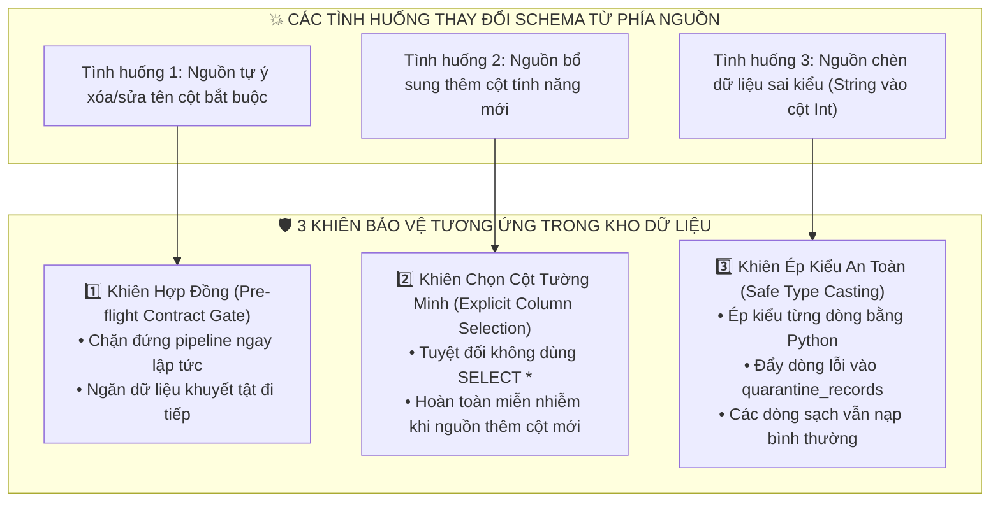
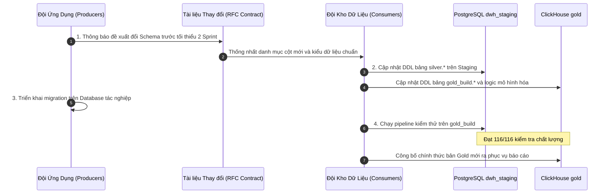

# 📜 HỢP ĐỒNG DỮ LIỆU & CAM KẾT RANH GIỚI KỸ THUẬT (DATA CONTRACT)
## Online Learning Data Warehouse (Operational-to-Analytical Interface Agreement)

> **Tóm tắt định hướng:**  
> Tài liệu này thiết lập **Hợp đồng Dữ liệu (Data Contract)** chính thức giữa Đội ngũ Phát triển Ứng dụng Nguồn (OLTP Data Producers) và Đội ngũ Kỹ sư Kho Dữ Liệu (DWH Data Consumers). Hợp đồng xác định rõ ràng trách nhiệm ranh giới, cấu trúc bảng bắt buộc, cơ chế kiểm soát sai lệch Schema (Schema Drift), thỏa thuận mức dịch vụ (SLA) và quy trình nâng cấp phiên bản dữ liệu an toàn.

---

## 📑 MỤC LỤC
1. [Tại Sao Cần Hợp Đồng Dữ Liệu?](#1-tại-sao-cần-hợp-đồng-dữ-liệu)
2. [Hợp Đồng Cấu Trúc Bảng Nguồn (Structural Schema Contract)](#2-hợp-đồng-cấu-trúc-bảng-nguồn-structural-schema-contract)
3. [Cơ Chế Kiểm Soát Hợp Đồng Tự Động (Pre-flight Contract Gate)](#3-cơ-chế-kiểm-soát-hợp-đồng-tự-động-pre-flight-contract-gate)
4. [Chính Sách Kiểm Soát Sai Lệch Cấu Trúc (3 Khiên Bảo Vệ Schema Drift)](#4-chính-sách-kiểm-soát-sai-lệch-cấu-trúc-3-khiên-bảo-vệ-schema-drift)
5. [Thỏa Thuận Mức Dịch Vụ & Trách Nhiệm Ranh Giới (SLA & Governance)](#5-thỏa-thuận-mức-dịch-vụ--trách-nhiệm-ranh-giới-sla--governance)
6. [Quy Trình Thay Đổi & Nâng Cấp Schema (Schema Evolution Policy)](#6-quy-trình-thay-đổi--nâng-cấp-schema-schema-evolution-policy)

---

## 1. Tại Sao Cần Hợp Đồng Dữ Liệu?

Trong thực tế doanh nghiệp, ranh giới giữa Đội ngũ Ứng dụng (Backend/Web) và Đội ngũ Kho Dữ Liệu (Data/BI) thường xuyên phát sinh xung đột:
* **Vấn đề từ phía Nguồn:** Lập trình viên backend tự ý đổi tên cột `paid_at` thành `payment_time`, hoặc đổi kiểu dữ liệu từ số thành chuỗi để phục vụ một tính năng mới của app, khiến toàn bộ Dashboard doanh thu của Ban Giám đốc bị sập.
* **Vấn đề từ phía Kho:** Đội dữ liệu viết những câu query khổng lồ quét thẳng vào cơ sở dữ liệu tác nghiệp vào ban ngày làm nghẽn CPU và giật lag hệ thống học của học viên.

> 🎯 **Nguyên tắc Cốt lõi của Data Contract:**  
> **"Tự do bên trong ứng dụng – Kỷ luật tuyệt đối ở ranh giới giao tiếp."**  
> Backend có thể tùy biến tính năng nội bộ, nhưng tại các bảng giao diện chia sẻ với Kho Dữ Liệu, cấu trúc dữ liệu, kiểu dữ liệu và ngữ nghĩa nghiệp vụ phải được cam kết bằng văn bản kỹ thuật và kiểm tra tự động trước mỗi lần nạp.

---

## 2. Hợp Đồng Cấu Trúc Bảng Nguồn (Structural Schema Contract)

Cơ sở dữ liệu tác nghiệp `learning_oltp` cam kết cung cấp tối thiểu 11 bảng quan hệ trong schema `oltp` với các tiêu chuẩn kỹ thuật bất biến:
1. **Kiểu Khóa Chính (Primary Key):** Bắt buộc phải là kiểu số nguyên lớn 64-bit (`BIGINT`), mang giá trị dương (`> 0`).
2. **Cột Dấu Mốc Cập Nhật (`updated_at`):** Bắt buộc phải tồn tại trên tất cả 11 bảng, mang kiểu `TIMESTAMPTZ` (có múi giờ), có chỉ mục (`INDEX`) và gắn trigger tự động cập nhật `oltp.touch_row()`.
3. **Danh mục các bảng và cột giao ước:**

| Tên Bảng Nguồn | Khóa Chính | Các Cột Hợp Đồng Bắt Buộc | Ràng Buộc Hợp Đồng |
| :--- | :--- | :--- | :--- |
| `oltp.users` | `user_id` (bigint) | `full_name`, `email`, `city`, `country`, `created_at`, `updated_at` | Email duy nhất, country 2 ký tự. |
| `oltp.user_history` | `history_id` (bigint) | `user_id`, `full_name`, `email`, `city`, `country`, `valid_from`, `valid_to`, `updated_at` | `valid_to > valid_from`, không được có khoảng trống (gap). |
| `oltp.instructors` | `instructor_id` (bigint)| `full_name`, `expertise`, `updated_at` | Không được để trống họ tên. |
| `oltp.courses` | `course_id` (bigint) | `instructor_id`, `title`, `category`, `difficulty`, `price_vnd`, `updated_at` | `price_vnd >= 0`. Phải trỏ đúng giảng viên hợp lệ. |
| `oltp.lessons` | `lesson_id` (bigint) | `course_id`, `title`, `position`, `updated_at` | `position BETWEEN 1 AND 10`. Duy nhất `(course_id, position)`. |
| `oltp.quizzes` | `quiz_id` (bigint) | `course_id`, `title`, `total_questions`, `updated_at` | `total_questions = 20`. |
| `oltp.payment_methods`| `method_id` (bigint) | `method_name`, `updated_at` | Tên phương thức duy nhất (bank_transfer, card, wallet). |
| `oltp.enrollments` | `enrollment_id` (bigint)| `user_id`, `course_id`, `enrolled_at`, `completed_at`, `lessons_completed`, `updated_at` | Duy nhất `(user_id, course_id)`. `completed_at >= enrolled_at`. |
| `oltp.payments` | `payment_id` (bigint) | `enrollment_id`, `user_id`, `course_id`, `method_id`, `transaction_id`, `paid_at`, `original_vnd`, `discount_vnd`, `charged_vnd`, `refunded`, `updated_at` | `charged_vnd = original_vnd - discount_vnd`. `refunded IN (0, 1)`. |
| `oltp.lesson_completions`| `completion_id` (bigint)| `enrollment_id`, `user_id`, `course_id`, `lesson_id`, `completed_at`, `time_spent_seconds`, `updated_at` | Duy nhất `(enrollment_id, lesson_id)`. `time_spent_seconds > 0`. |
| `oltp.quiz_attempts` | `attempt_id` (bigint) | `enrollment_id`, `user_id`, `course_id`, `quiz_id`, `attempt_number`, `attempted_at`, `correct_count`, `total_questions`, `time_spent_seconds`, `updated_at` | `correct_count BETWEEN 0 AND 20`. `time_spent_seconds > 0`. |

---

## 3. Cơ Chế Kiểm Soát Hợp Đồng Tự Động (Pre-flight Contract Gate)

Hợp đồng dữ liệu không phải là tài liệu nằm trên giấy mà được **kiểm tra tự động bằng code** ở dòng đầu tiên trước khi trích xuất bất kỳ dòng dữ liệu nào.

Đoạn mã thực thi trong [etl/stage.py](file:///run/media/tamdae/04C8A69DC8A68C8C/Users/LENOVO/Documents/TL_Kỳ_1_năm_4/Data_Warehouse/btl/etl/stage.py#L48-L56):
```python
# 1. Đọc danh sách cột kỳ vọng từ schema Staging
writer.execute("""
    SELECT column_name, data_type FROM information_schema.columns
    WHERE table_schema = 'silver' AND table_name = %s
    ORDER BY ordinal_position
""", (table,))
cols, types = map(list, zip(*writer.fetchall()))
key = cols[0]

# 2. Đọc cấu trúc thực tế từ cơ sở dữ liệu tác nghiệp
catalog.execute("""
    SELECT column_name, data_type FROM information_schema.columns
    WHERE table_schema = 'oltp' AND table_name = %s
""", (table,))
actual = dict(catalog.fetchall())

# 3. ĐỐI SOÁT HỢP ĐỒNG (FAIL-FAST):
# Nếu nguồn thiếu bất kỳ cột nào, hoặc updated_at không có múi giờ, hoặc khóa chính không phải bigint:
if not set(cols) <= actual.keys() or actual.get('updated_at') != 'timestamp with time zone' or actual.get(key) != 'bigint':
    raise RuntimeError(f'Vi phạm hợp đồng cấu trúc dữ liệu cho bảng oltp.{table}')
```

Nếu phía nguồn vi phạm hợp đồng (ví dụ: đổi tên cột `paid_at`), tiến trình ETL sẽ lập tức **dừng chạy ngay tại giây đầu tiên (Fail-fast)**, gửi thông báo lỗi chi tiết mà không làm sai lệch hay ghi dữ liệu rác vào kho.

---

## 4. Chính Sách Kiểm Soát Sai Lệch Cấu Trúc (3 Khiên Bảo Vệ Schema Drift)

Hệ thống được trang bị 3 khiên bảo vệ tương ứng với 3 tình huống sai lệch cấu trúc thực tế:



1. **Khi Nguồn Xóa / Đổi Tên Cột:** Bị chặn đứng bởi **Khiên 1 (Pre-flight Gate)**. Pipeline dừng lại an toàn, bảo vệ tính bất biến của bản Gold hiện tại.
2. **Khi Nguồn Thêm Cột Mới (ví dụ: `mobile_phone`, `device_type`):** Nhờ **Khiên 2 (Explicit Column Selection)**, câu lệnh trích xuất chỉ đọc chính xác danh sách cột trong hợp đồng: `SELECT payment_id, enrollment_id, paid_at... FROM oltp.payments`. Cột mới thêm ở nguồn không làm ảnh hưởng hay gây lỗi cho tiến trình nạp.
3. **Khi Nguồn Có Bản Ghi Sai Kiểu (ví dụ: chuỗi `abc` trong cột tiền):** Nhờ **Khiên 3 (Safe Type Casting)** trong [etl/schema_guard.py](file:///run/media/tamdae/04C8A69DC8A68C8C/Users/LENOVO/Documents/TL_Kỳ_1_năm_4/Data_Warehouse/btl/etl/schema_guard.py), dòng bị lỗi được gán mã `ERR_SCHEMA_TYPE_MISMATCH` và đưa sang bảng `quarantine_records`, còn hàng trăm ngàn dòng sạch khác vẫn được nạp thành công vào kho dữ liệu.

---

## 5. Thỏa Thuận Mức Dịch Vụ & Trách Nhiệm Ranh Giới (SLA & Governance)

### 5.1 Cam Kết Từ Phía Kho Dữ Liệu (DWH Team SLA)
* **Bảo vệ Hệ thống Tác nghiệp:** Đội ngũ Kho dữ liệu cam kết kết nối vào nguồn OLTP duy nhất bằng role `learning_reader` ở chế độ giao dịch chỉ đọc (`READ ONLY`) và mức cô lập `REPEATABLE READ`. Tuyệt đối không tạo bảng tạm, không ghi log và không thực hiện bất kỳ lệnh `UPDATE`/`DELETE` nào trên `learning_oltp`.
* **Kiểm soát Tải Trọng:** Trích xuất theo từng khối 50.000 dòng qua con trỏ máy chủ (Named Cursor), đảm bảo chiếm dụng bộ nhớ RAM máy chủ nguồn dưới 5% và không khóa bảng (Zero Locking).
* **Thời Gian Sẵn Sàng Báo Cáo:** Dữ liệu sau khi nạp tăng dần được cập nhật vào kho Gold và phản hồi trên Dashboard trong vòng **dưới 10 giây** cho lô 10.000 sự kiện mới.

### 5.2 Cam Kết Từ Phía Đội Ứng Dụng (Producer Team SLA)
* **Duy trì Trạng thái Trigger:** Đảm bảo trigger `touch_row()` luôn hoạt động để cột `updated_at` phản ánh chính xác thời điểm bản ghi được tạo hoặc sửa đổi.
* **Không Xóa Vật Lý (No Hard Deletes):** Đối với các dữ liệu lịch sử quan trọng (thanh toán, ghi danh), áp dụng xóa mềm (Soft Delete - gắn cờ `is_deleted = 1`) thay vì xóa vật lý khỏi bảng, giúp Kho Dữ Liệu không bị mất dấu vết đối soát.

---

## 6. Quy Trình Thay Đổi & Nâng Cấp Schema (Schema Evolution Policy)

Khi ứng dụng nguồn bắt buộc phải nâng cấp hoặc thay đổi cấu trúc bảng, hai đội tuân thủ quy trình 4 bước chuẩn mực:



Quy trình này loại bỏ hoàn toàn rủi ro "sập hệ thống bất ngờ", giúp doanh nghiệp tự tin mở rộng và phát triển các tính năng kinh doanh mới mà kho dữ liệu vẫn vận hành ổn định và chính xác.
