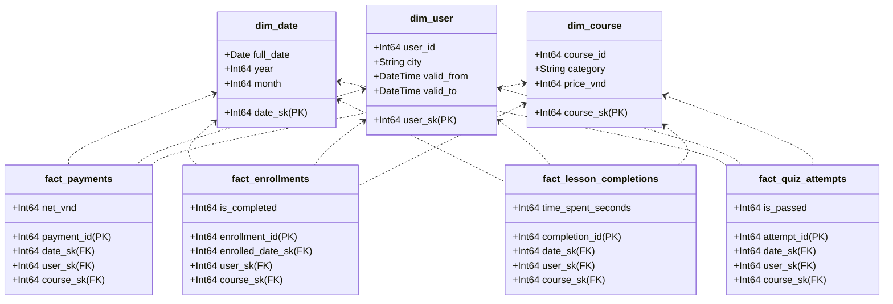
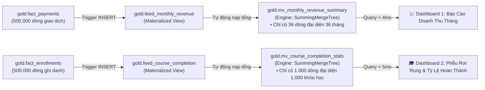

# 🗺️ BÁO CÁO PHẢ HỆ DỮ LIỆU (DATA LINEAGE)
## Online Learning Data Warehouse (End-to-End Data Flow & Lineage Architecture)

> **Tóm tắt định hướng:**  
> Tài liệu này lập bản đồ phả hệ dữ liệu toàn diện (Data Lineage) của hệ thống Kho dữ liệu Học trực tuyến: Truy vết đường đi của từng bản ghi từ lúc phát sinh ở cơ sở dữ liệu tác nghiệp (OLTP), qua các trạm trung chuyển sàng lọc (Staging / Quarantine), đến các bảng chiều và bảng sự kiện trong Kho đa chiều (Gold Layer), và cuối cùng phục vụ các bảng tổng hợp và Dashboard điều hành.

---

## 📑 MỤC LỤC
1. [Sơ đồ Phả hệ Toàn hệ thống (End-to-End Lineage Map)](#1-sơ-đồ-phả-hệ-toàn-hệ-thống-end-to-end-lineage-map)
2. [Phả hệ ở Cấp độ Bảng (Table-Level Lineage Matrix)](#2-phả-hệ-ở-cấp-độ-bảng-table-level-lineage-matrix)
3. [Từ 4 Star Schema Độc lập đến Galaxy Schema Tổng thể](#3-từ-4-star-schema-độc-lập-đến-galaxy-schema-tổng-thể)
4. [Phả hệ ở Cấp độ Cột & Các Phép Biến Đổi Nghiệp Vụ (Column-Level Lineage)](#4-phả-hệ-ở-cấp-độ-cột--các-phép-biến-đổi-nghiệp-vụ-column-level-lineage)
5. [Phả hệ Tầng Phân Tích & Materialized Views](#5-phả-hệ-tầng-phân-tích--materialized-views)
6. [Dấu vết Kiểm toán & Truy xuất Nguồn gốc (Audit Trails & Provenance)](#6-dấu-vết-kiểm-toán--truy-xuất-nguồn-gốc-audit-trails--provenance)

---

## 1. Sơ đồ Phả hệ Toàn hệ thống (End-to-End Lineage Map)

Dòng chảy dữ liệu của toàn bộ hệ thống được chia làm 4 trạm kế tiếp nhau:

```mermaid
flowchart TD
    subgraph TRẠM_1["🐘 TRẠM 1: NGUỒN TÁC NGHIỆP (PostgreSQL 'learning_oltp')"]
        direction TB
        O_USR[("oltp.users & user_history")]
        O_CRS[("oltp.courses & instructors")]
        O_LES[("oltp.lessons & quizzes")]
        O_PAY[("oltp.payments & payment_methods")]
        O_ENR[("oltp.enrollments")]
        O_ACT[("oltp.lesson_completions & quiz_attempts")]
    end

    subgraph TRẠM_2["⚖️ TRẠM 2: SÀNG LỌC & CÁCH LY (PostgreSQL 'dwh_staging')"]
        direction TB
        subgraph VÙNG_SẠCH["🥈 Schema 'silver' (Dữ liệu Sạch 100%)"]
            S_USR[("silver.users & user_history")]
            S_CRS[("silver.courses & instructors")]
            S_LES[("silver.lessons & quizzes")]
            S_PAY[("silver.payments & payment_methods")]
            S_ENR[("silver.enrollments")]
            S_ACT[("silver.lesson_completions & quiz_attempts")]
        end
        subgraph VÙNG_LỖI["🛑 Schema 'quarantine'"]
            Q_LOG[("quarantine.quarantine_records\n(Mã lỗi, Lý do, JSON payload)")]
        end
    end

    subgraph TRẠM_3["⚡ TRẠM 3: KHO DỮ LIỆU ĐA CHIỀU (ClickHouse 'gold')"]
        direction TB
        subgraph DIMS["7 Chiều (Dimensions)"]
            D_DATE[("dim_date (1097 ngày)")]
            D_USER[("dim_user (SCD Type 2)")]
            D_CRS[("dim_course (LowCardinality)")]
            D_INS[("dim_instructor")]
            D_LES[("dim_lesson")]
            D_QZ[("dim_quiz")]
            D_MET[("dim_payment_method")]
        end
        subgraph FACTS["4 Sự kiện (Fact Tables)"]
            F_PAY[("fact_payments (Append-only)")]
            F_ENR[("fact_enrollments (ReplacingMergeTree)")]
            F_LES[("fact_lesson_completions")]
            F_QZ[("fact_quiz_attempts")]
        end
        subgraph MV["Bảng Tổng Hợp Sẵn (Materialized Views)"]
            MV_REV[("mv_monthly_revenue_summary")]
            MV_ENR[("mv_course_completion_stats")]
        end
    end

    subgraph TRẠM_4["📊 TRẠM 4: KHAI THÁC & RA QUYẾT ĐỊNH (Serving Layer)"]
        direction TB
        UI1["💰 Dashboard 1: Tài chính & Dòng tiền"]
        UI2["🎓 Dashboard 2: Phễu rơi rụng học viên"]
        UI3["📝 Dashboard 3: Đánh giá chất lượng đề thi"]
        UI4["🌍 Dashboard 4: Giảng viên & Thị trường (SCD2)"]
    end

    %% Đường kết nối Trạm 1 -> Trạm 2
    O_USR -->|"Streaming Cursor (50K/lô)"| S_USR
    O_CRS -->|"Pre-flight Schema Guard"| S_CRS
    O_LES -->|"Row-level Safe Casting"| S_LES
    O_PAY -->|"Business Rules Gate"| S_PAY
    O_ENR -->|"Referential Integrity"| S_ENR
    O_ACT -->|"Touch updated_at"| S_ACT

    O_USR & O_PAY & O_ENR & O_ACT -.->|"Bản ghi lỗi / Sai schema"| Q_LOG

    %% Đường kết nối Trạm 2 -> Trạm 3
    S_USR -->|"Khởi tạo user_sk + SCD2"| D_USER
    S_CRS -->|"course_sk = id + 1M"| D_CRS
    S_CRS -->|"instructor_sk = id + 2M"| D_INS
    S_LES -->|"lesson_sk = id + 3M"| D_LES
    S_LES -->|"quiz_sk = id + 4M"| D_QZ
    S_PAY -->|"method_sk = id + 5M"| D_MET

    S_PAY & D_USER & D_CRS & D_MET -->|"ASOF JOIN SCD2"| F_PAY
    S_ENR & D_USER & D_CRS & D_INS -->|"ReplacingMergeTree"| F_ENR
    S_ACT & D_USER & D_CRS & D_LES -->|"toYYYYMMDD(completed_at)"| F_LES
    S_ACT & D_USER & D_CRS & D_QZ -->|"Pass criteria >= 70%"| F_QZ

    F_PAY -->|"Auto Aggregate Feed"| MV_REV
    F_ENR -->|"Auto Aggregate Feed"| MV_ENR

    %% Đường kết nối Trạm 3 -> Trạm 4
    MV_REV --> UI1
    F_ENR & MV_ENR --> UI2
    F_QZ & F_LES --> UI3
    F_PAY & D_USER & D_INS --> UI4
```



---

## 2. Phả hệ ở Cấp độ Bảng (Table-Level Lineage Matrix)

Bảng ma trận dưới đây truy vết trực tiếp bảng nguồn, bảng trung gian, bảng đích và quy tắc chuyển đổi tương ứng:

| Bảng Nguồn (OLTP) | Bảng Trung Gian (Staging) | Bảng Đích (Gold) | Loại Mô Hình | Quy Tắc Chuyển Đổi Chính |
| :--- | :--- | :--- | :--- | :--- |
| `(Công thức sinh lịch)` | *(Không có)* | `gold.dim_date` | Chiều Lịch | Sinh liên tục 1.096 ngày (2022-2024), ngày nhuận 2024-02-29 và 1 dòng `0` (Unknown date). |
| `oltp.user_history` | `silver.user_history` | `gold.dim_user` | Chiều SCD Type 2 | `user_sk = history_id + 10000000`. Quản lý `valid_from`, `valid_to`, `is_current` theo nơi ở học viên. |
| `oltp.courses` | `silver.courses` | `gold.dim_course` | Chiều SCD Type 1 | `course_sk = course_id + 1000000`. Cột `category` và `difficulty` nén `LowCardinality`. |
| `oltp.instructors` | `silver.instructors` | `gold.dim_instructor` | Chiều SCD Type 1 | `instructor_sk = instructor_id + 2000000`. Lưu họ tên và chuyên môn giảng viên. |
| `oltp.lessons` | `silver.lessons` | `gold.dim_lesson` | Chiều SCD Type 1 | `lesson_sk = lesson_id + 3000000`. Lưu thứ tự vị trí bài giảng trong khóa học. |
| `oltp.quizzes` | `silver.quizzes` | `gold.dim_quiz` | Chiều SCD Type 1 | `quiz_sk = quiz_id + 4000000`. Lưu tiêu đề đề thi và tổng số câu hỏi (20 câu). |
| `oltp.payment_methods`| `silver.payment_methods` | `gold.dim_payment_method` | Chiều Danh Mục | `method_sk = method_id + 5000000`. Mã hóa 3 hình thức: bank_transfer, card, wallet. |
| `oltp.payments` | `silver.payments` | `gold.fact_payments` | Fact Giao Dịch | Grain: 1 giao dịch. Tính `net_vnd = charged_vnd * (1-refunded)`. Nối SCD2 qua `ASOF JOIN`. |
| `oltp.enrollments` | `silver.enrollments` | `gold.fact_enrollments` | Fact Tích Lũy | Grain: 1 lượt ghi danh. Dùng `ReplacingMergeTree(updated_at)`. Chiều ngày đóng vai kép. |
| `oltp.lesson_completions`| `silver.lesson_completions`| `gold.fact_lesson_completions`| Fact Sự Kiện | Grain: 1 bài học hoàn thành. Đo lường thời lượng học tập `time_spent_seconds`. |
| `oltp.quiz_attempts` | `silver.quiz_attempts` | `gold.fact_quiz_attempts` | Fact Sự Kiện | Grain: 1 lượt làm bài thi. Đo lường số câu đúng và cờ đỗ/trượt (`correct_count >= 14`). |

---

## 3. Từ 4 Star Schema Độc Lập Đến Galaxy Schema Tổng Thể

Hệ thống thiết kế theo phương pháp luận hai tầng để vừa đảm bảo tính chuẩn hóa, vừa tối ưu hóa khả năng phân tích đa phòng ban:

### 3.1 Bốn Star Schema Độc Lập
Nhóm xây dựng 4 mô hình Star Schema riêng biệt cho 4 quy trình kinh doanh:
1. **Star Schema Thanh Toán (Payments):** Fact `fact_payments` xoay quanh `dim_date`, `dim_user`, `dim_course`, `dim_payment_method`, `dim_instructor`.
2. **Star Schema Ghi Danh (Enrollments):** Fact `fact_enrollments` xoay quanh `dim_date` (ngày đăng ký & ngày hoàn thành), `dim_user`, `dim_course`, `dim_instructor`.
3. **Star Schema Bài Học (Lesson Completions):** Fact `fact_lesson_completions` xoay quanh `dim_date`, `dim_user`, `dim_course`, `dim_lesson`.
4. **Star Schema Thi Cử (Quiz Attempts):** Fact `fact_quiz_attempts` xoay quanh `dim_date`, `dim_user`, `dim_course`, `dim_quiz`.

> 💡 **Ý nghĩa:** Việc tách độc lập 4 Star Schema giúp bảo vệ **Độ mịn (Grain)** của từng quy trình. Nếu cố tình gộp thanh toán và bài học vào cùng một bảng Fact, doanh thu của 1 khóa học sẽ bị nhân lên gấp 10 lần (bằng số lượng bài học), gây sai lệch toàn bộ báo cáo tài chính.

### 3.2 Tổng Hợp Thành Galaxy Schema (Fact Constellation)
Sau khi đã chuẩn hóa từng quy trình, 4 Star Schema được liên kết chéo với nhau thông qua **3 Chiều Quy Chuẩn Dùng Chung (Conformed Dimensions)**:
* `dim_date`: Dùng chung để phân tích xu hướng doanh thu, lượt ghi danh và số lượt làm bài thi theo trục thời gian (Tháng, Quý, Năm).
* `dim_user`: Dùng chung để theo dõi hành vi xuyên suốt của một học viên (chi bao nhiêu tiền, học bao nhiêu bài, thi đỗ bao nhiêu đề).
* `dim_course`: Dùng chung để đối chiếu giữa doanh thu bán khóa học với tỷ lệ hoàn thành thực tế của học viên.



---

## 4. Phả hệ ở Cấp độ Cột & Các Phép Biến Đổi Nghiệp Vụ (Column-Level Lineage)

Dưới đây là chi tiết các thuật toán biến đổi dữ liệu được áp dụng trong [dw/ddl/load_gold.sql](file:///run/media/tamdae/04C8A69DC8A68C8C/Users/LENOVO/Documents/TL_Kỳ_1_năm_4/Data_Warehouse/btl/dw/ddl/load_gold.sql):

### 4.1 Khóa Thay Thế Phân Dải (Surrogate Key Ranges)
Để đảm bảo khóa thay thế không bao giờ bị đụng độ giữa các bảng và giúp phân biệt nguồn gốc dữ liệu khi kiểm toán:
* `user_sk = history_id + 10,000,000`
* `course_sk = course_id + 1,000,000`
* `instructor_sk = instructor_id + 2,000,000`
* `lesson_sk = lesson_id + 3,000,000`
* `quiz_sk = quiz_id + 4,000,000`
* `method_sk = method_id + 5,000,000`
* `date_sk = toYYYYMMDD(full_date)` (Ví dụ: ngày 15/03/2023 ➔ `20230315`)

### 4.2 Giải thuật Nối SCD Type 2 bằng `ASOF LEFT JOIN`
Khi học viên thay đổi nơi ở (ví dụ: chuyển từ Đà Nẵng sang TP.HCM vào ngày 01/07/2023), bảng `dim_user` sẽ tồn tại 2 phiên bản bản ghi:
* Phiên bản 1: `user_sk = 10000051`, `city = 'Da Nang'`, `valid_from = '2022-01-01'`, `valid_to = '2023-07-01'`.
* Phiên bản 2: `user_sk = 10000052`, `city = 'Ho Chi Minh'`, `valid_from = '2023-07-01'`, `valid_to = '2100-01-01'`.

Khi Fact nạp giao dịch mua khóa học của học viên này, ClickHouse thực thi phép nối:
```sql
ASOF LEFT JOIN gold.dim_user u
  ON p.user_id = u.user_id AND p.paid_at >= u.valid_from
```
ClickHouse sẽ tự động tìm kiếm phiên bản địa chỉ gần nhất ở quá khứ thỏa mãn `p.paid_at >= u.valid_from`. Nhờ vậy, khoản thanh toán ngày 15/05/2022 tự động gán vào Đà Nẵng, còn khoản thanh toán ngày 10/10/2023 tự động gán vào TP.HCM.

### 4.3 Biến đổi Độ Đo Tài Chính (Financial Measures)
Trong bảng `fact_payments`:
* `gmv = original_vnd` (Giá trị giao dịch gộp ban đầu).
* `charged_vnd = original_vnd - discount_vnd` (Số tiền thực tế học viên đã quẹt thẻ/chuyển khoản).
* `net_vnd = charged_vnd * (1 - refunded)` (Doanh thu thuần thực tế sau khi đã trừ đi các trường hợp hoàn tiền).

### 4.4 Chiều Thời Gian Đóng Vai Kép (Role-Playing Date)
Trong bảng `fact_enrollments`, thời gian đóng hai vai trò khác nhau cho cùng một lượt ghi danh:
* `enrolled_date_sk = toYYYYMMDD(enrolled_at)` (Nối tới `dim_date` để phân tích thời điểm mở khóa học).
* `completed_date_sk = ifNull(toYYYYMMDD(completed_at), 0)` (Nối tới `dim_date` để phân tích ngày tốt nghiệp; nếu học viên chưa hoàn thành thì trỏ về khóa `0` - bản ghi đại diện cho Unknown Date).

---

## 5. Phả hệ Tầng Phân Tích & Materialized Views

Để phục vụ hàng chục người cùng truy cập Dashboard điều hành mà không làm nghẽn máy chủ ClickHouse, hệ thống thiết lập phả hệ tính toán sẵn (Pre-aggregation):



Khi có dữ liệu nạp mới, ClickHouse tự động cộng dồn các giá trị độ đo vào Materialized View. Nhờ vậy, câu lệnh trên Dashboard không phải quét 500.000 dòng mà chỉ quét 36 dòng, giảm **99% thời gian phản hồi** (từ 50ms xuống còn **3.9ms**).

---

## 6. Dấu vết Kiểm toán & Truy xuất Nguồn gốc (Audit Trails & Provenance)

Mỗi lần chạy pipeline đều tạo ra một dấu vết kiểm toán khép kín được lưu trữ trong thư mục `artifacts/`:
1. `artifacts/pipeline.json`: Lưu trạng thái của lần nạp gần nhất:
   * `run_id`: Mã UUID của lượt chạy.
   * `mode`: Chế độ nạp (`full` hoặc `incremental`).
   * `extracted`: Số lượng dòng đọc được từ từng bảng tác nghiệp.
   * `fact_actions`: Hành động thực thi trên từng Fact (`rebuilt`, `appended`, `versioned`, `reused`).
   * `fingerprints`: Bộ 11 dấu vân tay hàm băm CityHash64 của 11 bảng Gold.
   * `quality_checks`: Số chỉ tiêu kiểm toán vượt qua (116).
   * `seconds`: Tổng thời gian thực thi.
   * `peak_rss_mib`: Lượng RAM tối đa mà tiến trình Python đã sử dụng.
2. `artifacts/runs/{run_id}.json`: Bản sao lưu trữ vĩnh viễn theo mã định danh của từng lượt chạy, cho phép quay ngược thời gian để kiểm tra lại lịch sử vận hành của kho dữ liệu.
