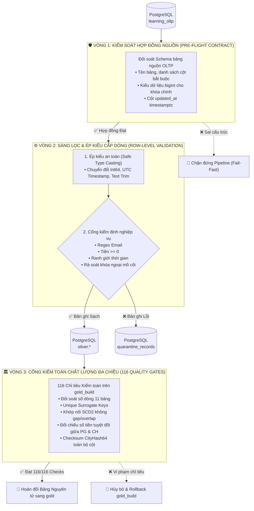
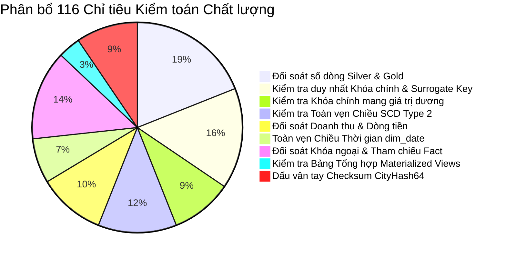
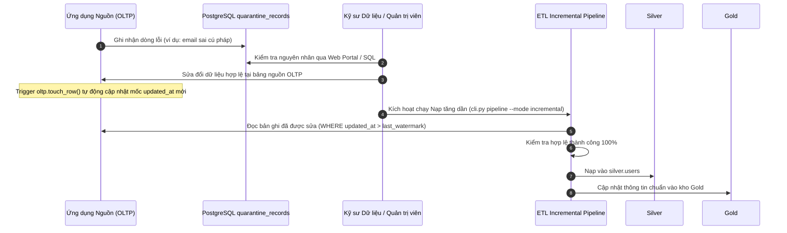

# 🛡️ BÁO CÁO QUẢN TRỊ CHẤT LƯỢNG DỮ LIỆU (DATA QUALITY)
## Online Learning Data Warehouse (DWH Architecture v2)

> **Tóm tắt định hướng:**  
> Tài liệu này mô tả chi tiết chiến lược, khung kiểm soát và quy trình thực thi **Chất lượng Dữ liệu (Data Quality)** của hệ thống Kho dữ liệu Học trực tuyến. Thay vì chỉ kiểm tra sơ sài sau khi nạp, hệ thống thiết lập cơ chế phòng thủ 3 vòng, kết hợp phân luồng cách ly dữ liệu lỗi (**Quarantine Pattern**) và **116 cổng kiểm toán chất lượng tự động (Quality Gates)** đạt độ chính xác 100%.

---

## 📑 MỤC LỤC
1. [Triết lý Quản trị Chất lượng Dữ liệu](#1-triết-lý-quản-trị-chất-lượng-dữ-liệu)
2. [Khung 6 Chiều Kích Chất Lượng (6 Dimensions of Data Quality)](#2-khung-6-chiều-kích-chất-lượng-6-dimensions-of-data-quality)
3. [Kiến trúc 3 Vòng Kiểm Soát (3-Tier Defense Architecture)](#3-kiến-trúc-3-vòng-kiểm-soát-3-tier-defense-architecture)
4. [Cơ chế Phân luồng Cách ly Dữ liệu Lỗi (Quarantine Pattern)](#4-cơ-chế-phân-luồng-cách-ly-dữ-liệu-lỗi-quarantine-pattern)
5. [Chi tiết 116 Cổng Kiểm Toán Chất Lượng (116 Automated Quality Gates)](#5-chi-tiết-116-cổng-kiểm-toán-chất-lượng-116-automated-quality-gates)
6. [Quy trình Giám sát, Đối soát & Tự Phục Hồi](#6-quy-trình-giám-sát-đối-soát--tự-phục-hồi)

---

## 1. Triết lý Quản trị Chất lượng Dữ liệu

Trong các kho dữ liệu truyền thống, dữ liệu bẩn thường bị xử lý theo hai cách cực đoan:
* **Cách 1 (Bỏ qua trong im lặng - Silent Drop):** Bản ghi lỗi bị xóa âm thầm trong bộ nhớ RAM của mã nguồn ETL, dẫn tới việc thất thoát doanh thu và lệch số liệu kế toán.
* **Cách 2 (Sập toàn bộ hệ thống - Hard Crash):** Chỉ một dòng dữ liệu sai kiểu làm đứng toàn bộ tiến trình nạp hàng triệu bản ghi, khiến các báo cáo phân tích cho ban giám đốc bị đình trệ.

Hệ thống Kho dữ liệu Học trực tuyến áp dụng **Triết lý Quản trị Hiện đại**:
1. **Không Nuốt Chửng Lỗi (Zero Silent Loss):** Mọi bản ghi vi phạm quy tắc đều phải được giữ lại nguyên vẹn trong khu cách ly chuyên biệt để phục vụ điều tra, kiểm toán.
2. **Bảo Vệ Tính Toàn Vẹn Của Kho Đích (Fail-Closed Delivery):** Kho dữ liệu phân tích (`gold`) chỉ tiếp nhận dữ liệu đã được làm sạch và chuẩn hóa 100%. Nếu có chỉ tiêu toàn vẹn bị vi phạm, hệ thống chặn việc công bố ngay lập tức.
3. **Minh Bạch & Tái Lập (Auditability & Reproducibility):** Mọi lượt chạy đều được gán mã định danh duy nhất (`run_id`), ghi nhận thời gian, tài nguyên tiêu thụ và lưu trữ dấu vân tay hàm băm (Fingerprints) để đối soát.

---

## 2. Khung 6 Chiều Kích Chất Lượng (6 Dimensions of Data Quality)

Hệ thống tuân thủ chặt chẽ 6 chiều kích chất lượng dữ liệu chuẩn quốc tế theo tổ chức DAMA (Data Management Association):

| Chiều kích | Định nghĩa nghiệp vụ | Cách thức kiểm soát trong hệ thống |
| :--- | :--- | :--- |
| **1. Tính Chính xác (Accuracy)** | Dữ liệu phải phản ánh đúng thực tế kinh doanh và các phương trình tài chính. | Kiểm tra phương trình dòng tiền: `Tiền thực thu = Giá gốc - Giảm giá`. So sánh đối soát doanh thu nguồn PostgreSQL khớp từng đồng với ClickHouse Gold. |
| **2. Tính Đầy đủ (Completeness)** | Không bị thất thoát bản ghi trong quá trình luân chuyển; không thiếu giá trị bắt buộc. | Kiểm toán đối soát số dòng 1:1 giữa Silver và Gold (`count parity`); kiểm tra các trường bắt buộc không được NULL (trừ `completed_at` khi chưa học xong). |
| **3. Tính Nhất quán (Consistency)** | Dữ liệu không mâu thuẫn giữa các bảng và các tầng lưu trữ. | Ràng buộc khóa ngoại: Không có khoản thanh toán hay lượt ghi danh nào trỏ tới khóa học không tồn tại (`reject_orphans`). Kiểm tra logic thời gian: Ngày hoàn thành phải sau ngày ghi danh. |
| **4. Tính Duy nhất (Uniqueness)** | Không tồn tại các bản ghi bị nhân đôi hay trùng lặp khóa. | Kiểm toán độ duy nhất của khóa tự nhiên (Business Key) và khóa thay thế (Surrogate Key) trên toàn bộ 11 bảng: `count() - uniqExact(key) == 0`. |
| **5. Tính Kịp thời (Timeliness)** | Dữ liệu phản ánh đúng trạng thái tại thời điểm phát sinh sự kiện. | Áp dụng chiều thay đổi chậm SCD Type 2 bằng phép nối theo mốc thời gian (`ASOF LEFT JOIN`), đảm bảo giao dịch năm 2022 thuộc Hà Nội, năm 2024 thuộc TP.HCM. |
| **6. Tính Hợp lệ (Validity)** | Dữ liệu tuân thủ đúng định dạng và miền giá trị cho phép. | Kiểm tra cú pháp Email qua Regex (`user@domain.ext`), mã quốc gia 2 ký tự in hoa (`VN`), số tiền thanh toán không được âm (`>= 0`). |

---

## 3. Kiến trúc 3 Vòng Kiểm Soát (3-Tier Defense Architecture)

Luồng dữ liệu từ lúc trích xuất đến khi lên báo cáo phải vượt qua 3 hàng rào bảo vệ kiên cố:



---

## 4. Cơ chế Phân luồng Cách ly Dữ liệu Lỗi (Quarantine Pattern)

Khi một bản ghi gặp lỗi, hệ thống không làm gián đoạn toàn bộ tiến trình mà đưa bản ghi đó vào **Khu Cách Ly (Quarantine Zone)** trên PostgreSQL Staging.

### 4.1 Cấu trúc Bảng Cách ly `quarantine.quarantine_records`
```sql
CREATE TABLE quarantine.quarantine_records (
    table_name          TEXT NOT NULL,            -- Tên bảng phát sinh lỗi (users, payments...)
    source_id           BIGINT NOT NULL,          -- Khóa chính của bản ghi lỗi ở nguồn
    source_updated_at   TIMESTAMPTZ NOT NULL,     -- Mốc thời gian cập nhật của bản ghi nguồn
    error_code          TEXT NOT NULL,            -- Mã định danh lỗi chuẩn hóa
    rejection_reason    TEXT NOT NULL,            -- Mô tả chi tiết nguyên nhân từ chối
    detected_at         TIMESTAMPTZ DEFAULT now(),-- Thời điểm hệ thống phát hiện lỗi
    raw_payload         JSONB NOT NULL,           -- Toàn bộ nội dung bản ghi gốc dạng JSON
    PRIMARY KEY (table_name, source_id, source_updated_at)
);
```

### 4.2 Danh mục Mã Lỗi & Hành Vi Xử Lý

| Mã lỗi (`error_code`) | Mức độ | Nguyên nhân kích hoạt | Tác động nghiệp vụ & Cách xử lý |
| :--- | :---: | :--- | :--- |
| `ERR_SCHEMA_TYPE_MISMATCH` | Nghiêm trọng | Giá trị không thể ép kiểu sang kiểu chuẩn (ví dụ: chữ trong cột tiền, chuỗi ngày sai format). | Cách ly dòng lỗi vào Quarantine. Giữ nguyên payload gốc. Báo cáo cho đội ngũ kỹ sư nguồn sửa lỗi ứng dụng. |
| `ERR_INVALID_EMAIL` | Cảnh báo | Email thiếu ký tự `@`, chứa khoảng trắng hoặc sai định dạng tên miền. | Cách ly dòng lỗi. Không nạp học viên này vào `silver.users` cho đến khi email được chuẩn hóa. |
| `ERR_NEGATIVE_AMOUNT` | Nghiêm trọng | Học phí, giá khóa học hoặc tiền giảm giá mang giá trị âm (`< 0`). | Cách ly dòng lỗi. Ngăn chặn số liệu doanh thu bị bóp méo hoặc âm tiền bất thường. |
| `ERR_INVALID_AMOUNT` | Nghiêm trọng | Phương trình tài chính sai lệch: `charged_vnd != original_vnd - discount_vnd`. | Cách ly dòng lỗi. Bảo vệ tính toàn vẹn của sổ cái kế toán và các báo cáo doanh thu. |
| `ERR_TIME_INCONSISTENCY` | Logic | Ngày học viên hoàn thành khóa học (`completed_at`) xảy ra trước ngày ghi danh (`enrolled_at`). | Cách ly dòng lỗi. Ngăn chặn việc tính toán sai thời lượng học và tỷ lệ hoàn thành. |
| `ERR_ORPHAN_COURSE` | Toàn vẹn | Khoản thanh toán hoặc lượt ghi danh trỏ tới `course_id` không tồn tại trong bảng `courses`. | Xóa khỏi lô nạp và đưa vào Quarantine. Đảm bảo mô hình Star Schema không bị lỗi khóa ngoại. |
| `ERR_ORPHAN_REFERENCE` | Toàn vẹn | Bản ghi trỏ tới `user_id`, `lesson_id` hoặc `quiz_id` không tồn tại trong bảng cha tương ứng. | Xóa khỏi lô nạp và đưa vào Quarantine. Ngăn chặn phát sinh dòng mồ côi trong Fact. |

---

## 5. Chi tiết 116 Cổng Kiểm Toán Chất Lượng (116 Automated Quality Gates)

Trước khi dữ liệu được công bố chính thức ra kho `gold`, hàm [etl/validate.py](file:///run/media/tamdae/04C8A69DC8A68C8C/Users/LENOVO/Documents/TL_Kỳ_1_năm_4/Data_Warehouse/btl/etl/validate.py) thực thi tự động **116 bài kiểm tra**:



### Chi tiết các nhóm kiểm toán:
1. **Đối soát Số lượng Dòng (Row Count Parity - 22 checks):**
   * Đối soát số lượng bản ghi của 11 bảng nguồn PostgreSQL khớp 1:1 với các bảng `silver.*` trong Staging.
   * Đối soát số lượng dòng từ Silver chuyển đổi chính xác sang các bảng Dimension tương ứng trong Gold.
2. **Tính Duy nhất & Hợp lệ của Khóa (Key Integrity - 29 checks):**
   * Kiểm tra độ trùng lặp (`count() - uniqExact(key) == 0`) trên toàn bộ 11 bảng Silver và 11 bảng Gold.
   * Kiểm tra tất cả các khóa chính phải mang giá trị nguyên dương (`key > 0`).
3. **Toàn vẹn Chiều Biến đổi Chậm SCD Type 2 (14 checks):**
   * Đảm bảo mỗi học viên chỉ có **duy nhất một bản ghi hiện hành** (`is_current = 1`).
   * Kiểm tra tính liên tục của khoảng thời gian: Không có khoảng trống (Gap) và không có khoảng đè chéo (Overlap) giữa các phiên bản địa chỉ của cùng một học viên.
   * Xác minh mỗi giao dịch trong Fact chỉ nối đúng với phiên bản địa chỉ có hiệu lực tại thời điểm thanh toán (`paid_at >= valid_from AND paid_at < valid_to`).
4. **Đối soát Dòng tiền & Tài chính Tuyệt đối (Financial Reconciliation - 12 checks):**
   * Kiểm tra từng dòng thanh toán: `net_vnd = charged_vnd * (1 - refunded)`.
   * Đối soát tổng tiền: Tính tổng độc lập `sum(net_vnd)`, `sum(charged_vnd)`, `sum(discount_vnd)` từ PostgreSQL Silver và so sánh với ClickHouse Gold — **kết quả phải trùng khớp 100% từng đồng lẻ**.
5. **Kiểm toán Bảng Tổng hợp Sẵn (Materialized Views - 4 checks):**
   * Kiểm tra bảng `gold.mv_monthly_revenue_summary` có tổng doanh thu thuần khớp chính xác với `sum(net_vnd)` của toàn bộ bảng sự kiện `gold.fact_payments`.
   * Kiểm tra bảng `gold.mv_course_completion_stats` có tổng lượt ghi danh khớp với `gold.fact_enrollments`.
6. **Kiểm tra Toàn vẹn Bằng Dấu Vân Tay (CityHash64 Fingerprints - 11 checks):**
   * Duyệt qua toàn bộ 11 bảng trong Gold, gom tất cả các cột thành chuỗi JSON và tính hàm băm `cityHash64`.
   * Kết quả tính tổng băm (`sum(hash)`) và phép XOR bit (`groupBitXor(hash)`) độc lập với thứ tự lưu trữ vật lý, đảm bảo hai lần chạy độc lập sinh ra dữ liệu đồng nhất 100%.

---

## 6. Quy trình Giám sát, Đối soát & Tự Phục Hồi

### 6.1 Giao diện Giám sát Trực quan (Quarantine Dashboard)
Người quản trị có thể theo dõi trực tiếp các vấn đề chất lượng dữ liệu thông qua tab **Cách ly** trên Web Portal (`http://localhost:8501`):
* Bảng thống kê số lượng bản ghi lỗi phân theo từng bảng và từng mã lỗi.
* Bảng chi tiết 20 bản ghi vi phạm gần nhất kèm lý do bị từ chối và mốc thời gian phát hiện.

### 6.2 Quy trình Xử lý Bản ghi Lỗi (Remediation Workflow)

Quá trình này đảm bảo tính khép kín: Dữ liệu bẩn không bao giờ lọt vào kho dữ liệu báo cáo, đồng thời có quy trình khắc phục rõ ràng, minh bạch.
