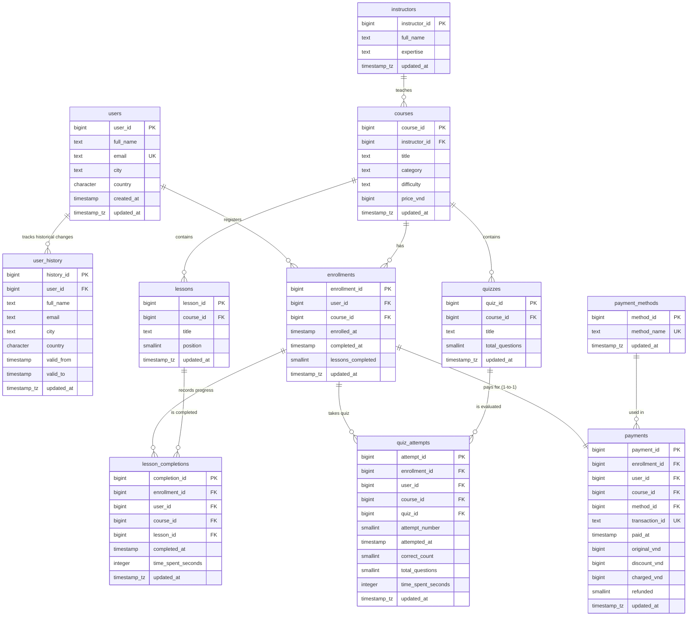
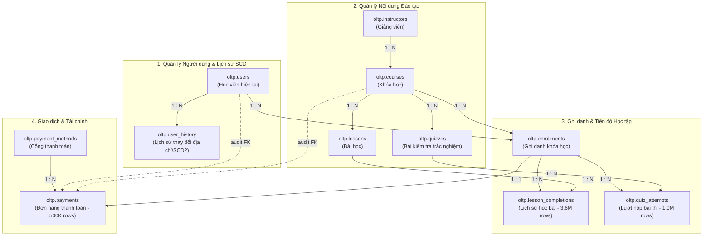

# ĐẶC TẢ CẤU TRÚC VÀ SƠ ĐỒ THỰC THỂ - QUAN HỆ (ERD) SCHEMA OLTP
> **Database:** `learning_oltp` | **Schema:** `oltp` | **Hệ quản trị:** PostgreSQL 16  
> **Quy mô dữ liệu:** 11 bảng, hơn 5.72 triệu bản ghi giao dịch thực tế (2022–2024).

---

## 📌 1. SƠ ĐỒ THỰC THỂ - QUAN HỆ TOÀN DIỆN (MERMAID ER DIAGRAM)

Sơ đồ ERD thể hiện 11 thực thể của hệ thống học trực tuyến, bao gồm đầy đủ các trường khóa chính (**PK**), khóa ngoại (**FK**), ràng buộc duy nhất (**UK**) và bản số quan hệ (Cardinality):



---

## 🗂️ 2. PHÂN NHÓM NGHIỆP VỤ & LUỒNG QUAN HỆ (FLOWCHART)

Mô hình tác nghiệp được cấu trúc thành 4 phân hệ cốt lõi:



---

## 📋 3. BẢNG ĐẶC TẢ CHI TIẾT 11 BẢNG TRONG SCHEMA `oltp`

### 3.1. Bảng `oltp.users` (Học viên hiện tại)
* **Vai trò:** Lưu trữ thông tin hiện thời của tài khoản học viên trong hệ thống.
* **Số lượng ước tính:** 50,000 dòng.

| Tên Cột | Kiểu Dữ Liệu | Ràng Buộc | Ý Nghĩa Nghiệp Vụ |
| :--- | :--- | :---: | :--- |
| `user_id` | `bigint` | **PK** | Định danh duy nhất của học viên. |
| `full_name` | `text` | NOT NULL | Họ và tên đầy đủ của học viên. |
| `email` | `text` | **UK**, NOT NULL | Email đăng nhập (ràng buộc duy nhất toàn hệ thống). |
| `city` | `text` | NOT NULL | Tỉnh / Thành phố cư trú hiện tại (ví dụ: Ha Noi, Ho Chi Minh, Da Nang). |
| `country` | `character(2)` | NOT NULL | Mã quốc gia chuẩn ISO (mặc định `'VN'`). |
| `created_at` | `timestamp` | NOT NULL | Thời điểm học viên đăng ký tài khoản lần đầu. |
| `updated_at` | `timestamptz` | NOT NULL | Thời điểm cập nhật cuối cùng (tự động cập nhật bởi Trigger). |

---

### 3.2. Bảng `oltp.user_history` (Lịch sử địa lý - Hỗ trợ SCD Type 2)
* **Vai trò:** Lưu vết thay đổi địa lý của học viên theo thời gian hiệu lực (`valid_from` đến `valid_to`).
* **Số lượng ước tính:** 60,000 dòng (bao gồm 10,000 trường hợp học viên đổi nơi cư trú).

| Tên Cột | Kiểu Dữ Liệu | Ràng Buộc | Ý Nghĩa Nghiệp Vụ |
| :--- | :--- | :---: | :--- |
| `history_id` | `bigint` | **PK** | Khóa chính của bản ghi lịch sử. |
| `user_id` | `bigint` | **FK** (`users.user_id`) | Mã học viên tham chiếu. |
| `full_name` | `text` | NOT NULL | Họ tên tại thời điểm hiệu lực. |
| `email` | `text` | NOT NULL | Email tại thời điểm hiệu lực. |
| `city` | `text` | NOT NULL | Nơi cư trú trong giai đoạn hiệu lực tương ứng. |
| `country` | `character(2)` | NOT NULL | Mã quốc gia. |
| `valid_from` | `timestamp` | NOT NULL | Ngày bắt đầu có hiệu lực tại địa phương này. |
| `valid_to` | `timestamp` | NOT NULL | Ngày kết thúc hiệu lực (phiên bản hiện thời là vô tận: `2100-01-01`). |
| `updated_at` | `timestamptz` | NOT NULL | Thời điểm ghi nhận bản ghi lịch sử. |

> **Ràng buộc duy nhất:** `UNIQUE (user_id, valid_from)`.

---

### 3.3. Bảng `oltp.instructors` (Giảng viên)
* **Vai trò:** Danh mục giảng viên tham gia biên soạn và giảng dạy khóa học.
* **Số lượng ước tính:** 100 dòng.

| Tên Cột | Kiểu Dữ Liệu | Ràng Buộc | Ý Nghĩa Nghiệp Vụ |
| :--- | :--- | :---: | :--- |
| `instructor_id` | `bigint` | **PK** | Mã giảng viên. |
| `full_name` | `text` | NOT NULL | Họ tên giảng viên. |
| `expertise` | `text` | NOT NULL | Chuyên môn giảng dạy (Data Engineering, AI, Web Development, DevOps...). |
| `updated_at` | `timestamptz` | NOT NULL | Thời điểm cập nhật hồ sơ giảng viên. |

---

### 3.4. Bảng `oltp.courses` (Khóa học)
* **Vai trò:** Danh mục các khóa học trực tuyến đang được phát hành trên nền tảng.
* **Số lượng ước tính:** 1,000 dòng.

| Tên Cột | Kiểu Dữ Liệu | Ràng Buộc | Ý Nghĩa Nghiệp Vụ |
| :--- | :--- | :---: | :--- |
| `course_id` | `bigint` | **PK** | Mã khóa học duy nhất. |
| `instructor_id` | `bigint` | **FK** (`instructors`) | Giảng viên phụ trách khóa học. |
| `title` | `text` | NOT NULL | Tiêu đề khóa học. |
| `category` | `text` | NOT NULL | Phân mục đào tạo (Engineering, Business, Design, Science, ...). |
| `difficulty` | `text` | NOT NULL | Độ khó (Beginner, Intermediate, Advanced). |
| `price_vnd` | `bigint` | NOT NULL | Giá niêm yết của khóa học (VND). |
| `updated_at` | `timestamptz` | NOT NULL | Thời điểm cập nhật nội dung khóa học. |

---

### 3.5. Bảng `oltp.lessons` (Bài học trong khóa học)
* **Vai trò:** Danh sách các bài giảng chi tiết thuộc từng khóa học. Mỗi khóa học gồm 10 bài học.
* **Số lượng ước tính:** 10,000 dòng.

| Tên Cột | Kiểu Dữ Liệu | Ràng Buộc | Ý Nghĩa Nghiệp Vụ |
| :--- | :--- | :---: | :--- |
| `lesson_id` | `bigint` | **PK** | Mã bài học duy nhất. |
| `course_id` | `bigint` | **FK** (`courses`) | Khóa học chứa bài học này. |
| `title` | `text` | NOT NULL | Tiêu đề bài học. |
| `position` | `smallint` | NOT NULL | Thứ tự bài học trong khóa (từ 1 đến 10). |
| `updated_at` | `timestamptz` | NOT NULL | Thời điểm cập nhật bài học. |

> **Ràng buộc duy nhất:** `UNIQUE (course_id, position)` (mỗi khóa học chỉ có 1 bài ở vị trí tương ứng).

---

### 3.6. Bảng `oltp.quizzes` (Bài kiểm tra trắc nghiệm)
* **Vai trò:** Bài kiểm tra tổng hợp cuối khóa học để đánh giá năng lực học viên.
* **Số lượng ước tính:** 1,000 dòng.

| Tên Cột | Kiểu Dữ Liệu | Ràng Buộc | Ý Nghĩa Nghiệp Vụ |
| :--- | :--- | :---: | :--- |
| `quiz_id` | `bigint` | **PK** | Mã bài thi trắc nghiệm. |
| `course_id` | `bigint` | **FK** (`courses`) | Khóa học liên kết với bài thi này. |
| `title` | `text` | NOT NULL | Tên bài kiểm tra. |
| `total_questions` | `smallint` | NOT NULL | Tổng số câu hỏi trắc nghiệm trong đề (thường là 10 câu). |
| `updated_at` | `timestamptz` | NOT NULL | Thời điểm cập nhật đề thi. |

---

### 3.7. Bảng `oltp.enrollments` (Ghi danh khóa học)
* **Vai trò:** Ghi nhận sự kiện học viên đăng ký tham gia một khóa học.
* **Số lượng ước tính:** 500,000 dòng.

| Tên Cột | Kiểu Dữ Liệu | Ràng Buộc | Ý Nghĩa Nghiệp Vụ |
| :--- | :--- | :---: | :--- |
| `enrollment_id` | `bigint` | **PK** | Mã lượt đăng ký khóa học. |
| `user_id` | `bigint` | **FK** (`users`) | Học viên đăng ký. |
| `course_id` | `bigint` | **FK** (`courses`) | Khóa học được đăng ký. |
| `enrolled_at` | `timestamp` | NOT NULL | Thời điểm đăng ký tham gia. |
| `completed_at` | `timestamp` | NULL | Thời điểm học viên hoàn thành khóa học (NULL nếu chưa xong). |
| `lessons_completed` | `smallint` | NOT NULL | Số bài học đã hoàn thành tích lũy (từ 0 đến 10). |
| `updated_at` | `timestamptz` | NOT NULL | Thời điểm cập nhật tiến độ gần nhất. |

> **Ràng buộc duy nhất:** `UNIQUE (user_id, course_id)` (mỗi học viên chỉ ghi danh 1 lần vào 1 khóa học).

---

### 3.8. Bảng `oltp.lesson_completions` (Tiến độ học bài chi tiết)
* **Vai trò:** Ghi nhận từng bài học cụ thể mà học viên đã học xong.
* **Số lượng ước tính:** 3,600,000 dòng (bảng có dung lượng lớn nhất trong hệ thống tác nghiệp).

| Tên Cột | Kiểu Dữ Liệu | Ràng Buộc | Ý Nghĩa Nghiệp Vụ |
| :--- | :--- | :---: | :--- |
| `completion_id` | `bigint` | **PK** | Mã lượt hoàn thành bài học. |
| `enrollment_id` | `bigint` | **FK** (`enrollments`) | Lượt ghi danh tương ứng. |
| `user_id` | `bigint` | **FK** (`users`) | Học viên học bài. |
| `course_id` | `bigint` | **FK** (`courses`) | Khóa học đang học. |
| `lesson_id` | `bigint` | **FK** (`lessons`) | Bài học cụ thể đã hoàn thành. |
| `completed_at` | `timestamp` | NOT NULL | Thời điểm ấn nút hoàn thành bài học. |
| `time_spent_seconds` | `integer` | NOT NULL | Thời lượng học thực tế (giây). |
| `updated_at` | `timestamptz` | NOT NULL | Thời điểm đồng bộ tiến độ. |

> **Ràng buộc duy nhất:** `UNIQUE (enrollment_id, lesson_id)` (không học trùng 1 bài học 2 lần trong 1 lượt ghi danh).

---

### 3.9. Bảng `oltp.quiz_attempts` (Lượt làm bài kiểm tra)
* **Vai trò:** Nhật ký nộp bài trắc nghiệm của học viên (mỗi học viên có thể thi lại nhiều lần: `attempt_number` = 1, 2, ...).
* **Số lượng ước tính:** 1,000,000+ dòng.

| Tên Cột | Kiểu Dữ Liệu | Ràng Buộc | Ý Nghĩa Nghiệp Vụ |
| :--- | :--- | :---: | :--- |
| `attempt_id` | `bigint` | **PK** | Mã lượt làm bài thi trắc nghiệm. |
| `enrollment_id` | `bigint` | **FK** (`enrollments`) | Lượt ghi danh của lần thi này. |
| `user_id` | `bigint` | **FK** (`users`) | Học viên làm bài. |
| `course_id` | `bigint` | **FK** (`courses`) | Khóa học liên quan. |
| `quiz_id` | `bigint` | **FK** (`quizzes`) | Đề thi trắc nghiệm được làm. |
| `attempt_number` | `smallint` | NOT NULL | Số thứ tự lần thi (Lần 1, Lần 2, ...). |
| `attempted_at` | `timestamp` | NOT NULL | Thời điểm nộp bài thi. |
| `correct_count` | `smallint` | NOT NULL | Số câu trả lời chính xác đạt được. |
| `total_questions` | `smallint` | NOT NULL | Tổng số câu hỏi của bài thi. |
| `time_spent_seconds` | `integer` | NOT NULL | Thời gian hoàn thành bài thi (giây). |
| `updated_at` | `timestamptz` | NOT NULL | Thời điểm ghi nhận kết quả. |

> **Ràng buộc duy nhất:** `UNIQUE (enrollment_id, quiz_id, attempt_number)`.

---

### 3.10. Bảng `oltp.payment_methods` (Phương thức thanh toán)
* **Vai trò:** Danh mục các cổng và hình thức thanh toán được hỗ trợ.
* **Số lượng ước tính:** 3 dòng.

| Tên Cột | Kiểu Dữ Liệu | Ràng Buộc | Ý Nghĩa Nghiệp Vụ |
| :--- | :--- | :---: | :--- |
| `method_id` | `bigint` | **PK** | Mã phương thức thanh toán. |
| `method_name` | `text` | **UK**, NOT NULL | Tên phương thức: `credit_card`, `bank_transfer`, `momo`. |
| `updated_at` | `timestamptz` | NOT NULL | Thời điểm cập nhật danh mục. |

---

### 3.11. Bảng `oltp.payments` (Giao dịch tài chính thanh toán)
* **Vai trò:** Đơn hàng thanh toán học phí cho từng lượt ghi danh khóa học.
* **Số lượng ước tính:** 500,000 dòng.

| Tên Cột | Kiểu Dữ Liệu | Ràng Buộc | Ý Nghĩa Nghiệp Vụ |
| :--- | :--- | :---: | :--- |
| `payment_id` | `bigint` | **PK** | Mã giao dịch thanh toán duy nhất. |
| `enrollment_id` | `bigint` | **FK**, **UK** | Mỗi lượt ghi danh chỉ tương ứng với đúng 1 giao dịch thanh toán (Quan hệ 1-1). |
| `user_id` | `bigint` | **FK** (`users`) | Người thực hiện thanh toán. |
| `course_id` | `bigint` | **FK** (`courses`) | Khóa học được thanh toán. |
| `method_id` | `bigint` | **FK** (`payment_methods`) | Hình thức thanh toán đã chọn. |
| `transaction_id` | `text` | **UK**, NOT NULL | Mã tham chiếu giao dịch cổng thanh toán (chuỗi UUID). |
| `paid_at` | `timestamp` | NOT NULL | Thời điểm thanh toán thành công. |
| `original_vnd` | `bigint` | NOT NULL | Giá gốc của khóa học tại thời điểm mua (VND). |
| `discount_vnd` | `bigint` | NOT NULL | Số tiền được giảm giá / khuyến mãi (VND). |
| `charged_vnd` | `bigint` | NOT NULL | Số tiền thực tế học viên phải trả (`original_vnd - discount_vnd`). |
| `refunded` | `smallint` | NOT NULL | Cờ hoàn tiền: `0` = Hợp lệ, `1` = Đã hoàn trả lại tiền. |
| `updated_at` | `timestamptz` | NOT NULL | Thời điểm giao dịch được cập nhật trạng thái. |

---

## ⚡ 4. CƠ CHẾ TRIGGER TỰ ĐỘNG CẬP NHẬT `updated_at` (CHANGE CAPTURE)

Toàn bộ 11 bảng trong schema `oltp` đều gắn với hàm trigger `oltp.set_updated_at()`:

```sql
CREATE OR REPLACE FUNCTION oltp.set_updated_at()
RETURNS trigger AS $$
BEGIN
    NEW.updated_at = clock_timestamp();
    RETURN NEW;
END;
$$ LANGUAGE plpgsql;
```

### 🎯 Ý nghĩa kiến trúc:
1. **Theo dõi biến động (Data Change Auditing):** Bất cứ khi nào ứng dụng nguồn thêm mới (`INSERT`) hoặc cập nhật (`UPDATE`) một bản ghi (ví dụ học viên hoàn thành bài học, nộp bài kiểm tra hoặc thay đổi trạng thái hoàn tiền), cột `updated_at` sẽ được gán tức thời bằng `clock_timestamp()` của hệ điều hành.
2. **Nạp Tăng Dần (Incremental High Water Mark):** Pipeline ETL không cần đọc lại toàn bộ hàng triệu bản ghi, mà chỉ cần truy vấn:
   ```sql
   WHERE updated_at > :last_watermark_processed
   ```
   giúp trích xuất dữ liệu mới chỉ trong vài giây.
