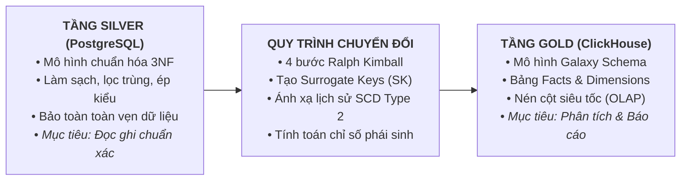
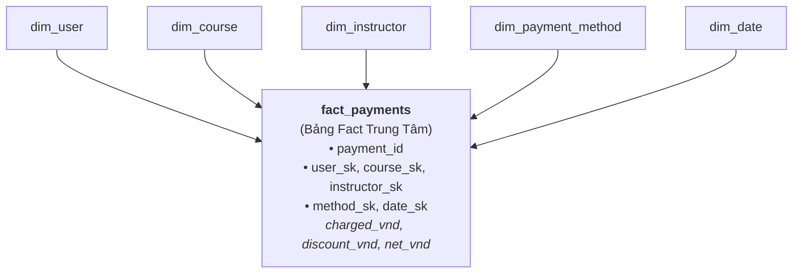
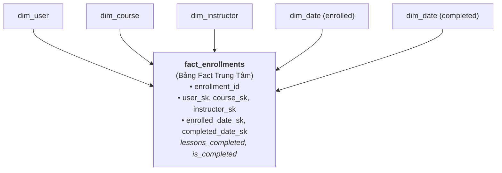
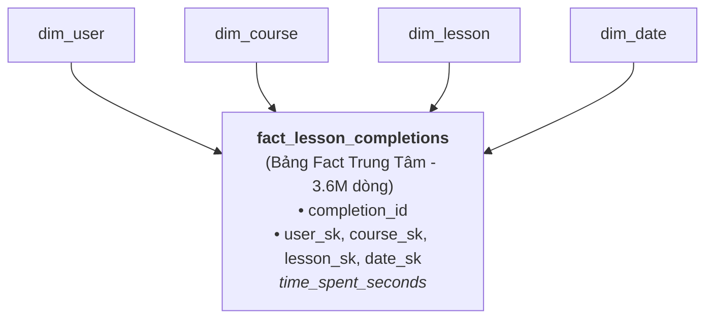
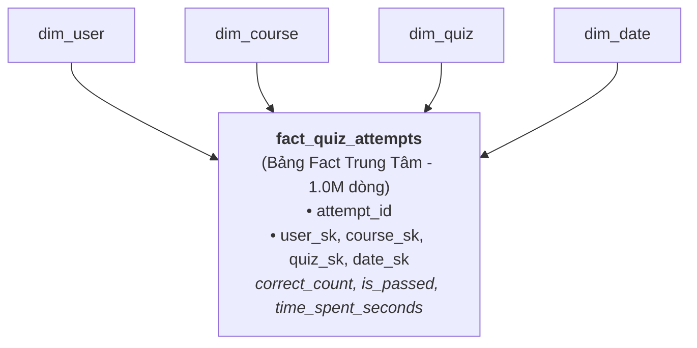
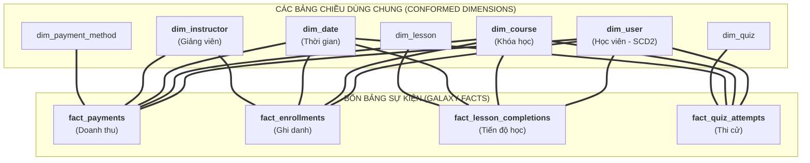
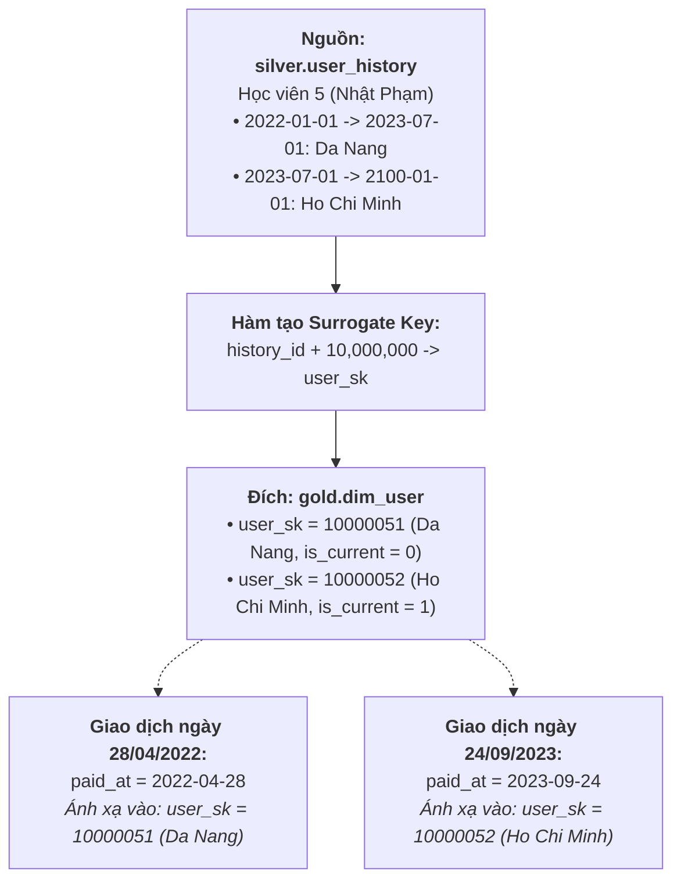
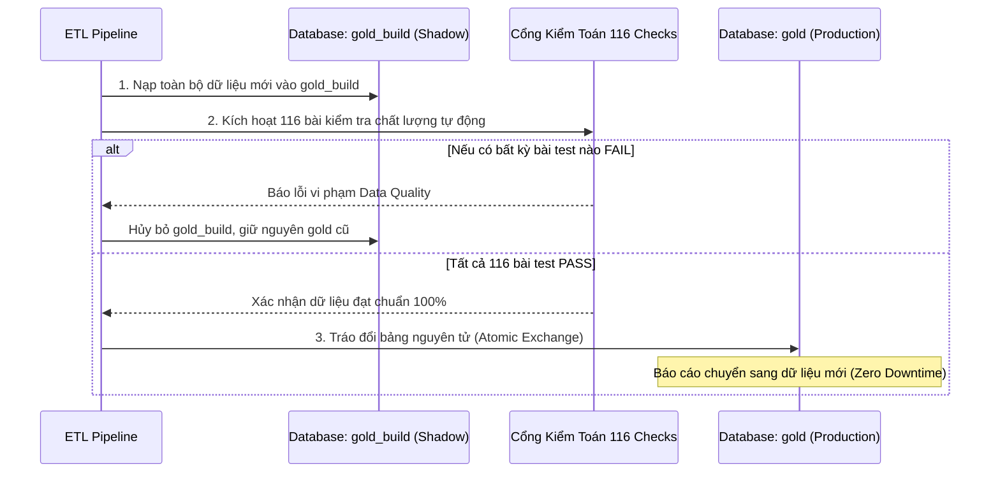

# QUY TRÌNH XÂY DỰNG MÔ HÌNH HÓA DỮ LIỆU TỪ SILVER SANG GOLD
> **Tài liệu Kỹ thuật & Lý thuyết Nền tảng**  
> *Dự án:* Online Learning Data Warehouse (Hệ thống Kho Dữ liệu Học Trực tuyến 2022–2024)  
> *Mục tiêu:* Hướng dẫn phương pháp luận và các bước chuyển dịch dữ liệu từ tầng sạch (Silver - 3NF) sang kho đa chiều (Gold - Galaxy Schema).

---

## 🧭 1. TRIẾT LÝ CHUYỂN DỊCH TỪ SILVER SANG GOLD

Trong kiến trúc kho dữ liệu hiện đại (**Medallion Architecture**), hai tầng Silver và Gold phục vụ hai mục đích hoàn toàn khác nhau:



### Tại sao không thể dùng trực tiếp tầng Silver để báo cáo?
1. **Độ phức tạp của câu truy vấn (Query Complexity):** Tầng Silver được thiết kế ở dạng **Chuẩn hóa bậc 3 (3NF)** để chống dư thừa khi ghi dữ liệu. Để trả lời một câu hỏi kinh doanh cơ bản như *"Doanh thu theo tỉnh thành và chuyên môn giảng viên"*, người phân tích phải viết câu lệnh `JOIN` qua 5 đến 6 bảng khác nhau. Điều này vừa dễ gây nhầm lẫn số liệu, vừa đòi hỏi người dùng phải có chuyên môn sâu về cơ sở dữ liệu.
2. **Hiệu năng quét dữ liệu (OLAP vs OLTP):** Silver lưu trữ theo từng dòng (Row-oriented) trên PostgreSQL. Khi chạy các câu truy vấn tổng hợp trên hàng triệu bản ghi, hệ thống phải nạp toàn bộ các cột của dòng vào bộ nhớ, gây nghẽn I/O.
3. **Biến động lịch sử (Temporal Blindness):** Silver chỉ lưu trạng thái hiện tại của dữ liệu. Nếu học viên chuyển đổi nơi cư trú từ Đà Nẵng vào TP.HCM, toàn bộ doanh thu quá khứ của học viên đó sẽ bị tính nhầm cho TP.HCM.

Tầng **Gold** ra đời để giải quyết triệt để 3 vấn đề trên bằng phương pháp **Mô hình hóa Chiều (Dimensional Modeling)**.

---

## 📚 2. CƠ SỞ LÝ THUYẾT: QUY TRÌNH 4 BƯỚC CỦA RALPH KIMBALL

Quy trình xây dựng tầng Gold của dự án tuân thủ nghiêm ngặt phương pháp luận 4 bước chuẩn mực của **Ralph Kimball** (cha đẻ của ngành Mô hình hóa Dữ liệu):

```
┌─────────────────────────────────┐
│ Bước 1: Chọn Quy trình Nghiệp vụ │ (Business Process)
└────────────────┬────────────────┘
                 │
                 ▼
┌─────────────────────────────────┐
│ Bước 2: Tuyên bố Độ hạt Dữ liệu │ (Declare the Grain)
└────────────────┬────────────────┘
                 │
                 ▼
┌─────────────────────────────────┐
│ Bước 3: Xác định các Chiều Phân tích (Identify Dimensions)
└────────────────┬────────────────┘
                 │
                 ▼
┌─────────────────────────────────┐
│ Bước 4: Xác định Sự kiện & Chỉ số (Facts & Measures)
└─────────────────────────────────┘
```

### Bước 1: Chọn quy trình nghiệp vụ (Select the Business Process)
Quy trình nghiệp vụ là các hoạt động thực tế mang lại giá trị hoặc tạo ra dữ liệu trong tổ chức. Hệ thống học trực tuyến xác định **4 quy trình nghiệp vụ cốt lõi**:
1. **Quy trình Thanh toán học phí (Payments):** Ghi nhận dòng tiền thanh toán đơn hàng của học viên.
2. **Quy trình Ghi danh khóa học (Enrollments):** Học viên bắt đầu tham gia một khóa đào tạo và theo dõi lộ trình tốt nghiệp.
3. **Quy trình Học tập từng bài học (Lesson Progress):** Ghi nhận tương tác học tập chi tiết của học viên trên từng video bài giảng.
4. **Quy trình Đánh giá năng lực (Quiz Attempts):** Ghi nhận kết quả làm bài thi trắc nghiệm để đo lường chất lượng đào tạo.

### Bước 2: Tuyên bố độ hạt dữ liệu (Declare the Grain)
Độ hạt (Grain) xác định chính xác **một dòng trong bảng Fact đại diện cho cái gì**. Tuyên bố độ hạt sai là nguyên nhân số một gây sai lệch số liệu khi tính toán tổng hợp:
- **`fact_payments`:** Mỗi dòng đại diện cho **đúng một giao dịch thanh toán cụ thể** qua cổng thanh toán (`payment_id`).
- **`fact_enrollments`:** Mỗi dòng đại diện cho **một lượt học viên đăng ký tham gia một khóa học** (`enrollment_id`).
- **`fact_lesson_completions`:** Mỗi dòng đại diện cho **một lần học viên ấn nút hoàn thành một bài học** (`completion_id`).
- **`fact_quiz_attempts`:** Mỗi dòng đại diện cho **một lần học viên nộp bài thi trắc nghiệm** (`attempt_id`).

### Bước 3: Xác định các chiều phân tích (Identify the Dimensions)
Các chiều phân tích trả lời cho các câu hỏi: *Ai? Cái gì? Ở đâu? Khi nào? Như thế nào?*:
- **Học viên là ai?** $\rightarrow$ `dim_user` (Họ tên, email, thành phố, quốc gia, lịch sử nơi ở).
- **Khóa học nào?** $\rightarrow$ `dim_course` (Tiêu đề, phân mục, độ khó, giá niêm yết).
- **Giảng viên nào dạy?** $\rightarrow$ `dim_instructor` (Họ tên, chuyên môn).
- **Bài học cụ thể nào?** $\rightarrow$ `dim_lesson` (Tiêu đề bài học, thứ tự bài trong khóa).
- **Đề thi nào?** $\rightarrow$ `dim_quiz` (Tên đề kiểm tra, tổng số câu hỏi).
- **Hình thức trả tiền nào?** $\rightarrow$ `dim_payment_method` (Thẻ tín dụng, chuyển khoản, ví điện tử).
- **Thời gian nào?** $\rightarrow$ `dim_date` (Năm, quý, tháng, ngày, thứ trong tuần).

### Bước 4: Xác định các sự kiện và chỉ số đo lường (Identify Facts & Measures)
Các chỉ số đo lường là các giá trị số học (thường là cộng dồn được - Additive) sinh ra từ sự kiện:
- **Chỉ số doanh thu:** `original_vnd`, `discount_vnd`, `charged_vnd`, `net_vnd` (doanh thu thực sau hoàn tiền).
- **Chỉ số học tập:** `time_spent_seconds` (thời lượng học tính bằng giây), `lessons_completed` (số bài học tích lũy).
- **Chỉ số thi cử:** `correct_count` (số câu làm đúng), `total_questions`, cờ tốt nghiệp `is_passed`.

---

## 🌟 3. TỪ 4 MÔ HÌNH STAR SCHEMA ĐẾN GALAXY SCHEMA HỢP NHẤT

Để thiết kế một hệ thống Data Warehouse lớn mà không bị rối rắm, phương pháp luận chuẩn xác nhất là:  
👉 **Thiết kế độc lập từng Star Schema cho từng quy trình nghiệp vụ.**  
👉 **Sau đó tổng hợp lại thành Galaxy Schema thông qua các Chiều Dùng Chung (Conformed Dimensions).**

### 3.1. Thiết kế 4 Star Schema độc lập

#### ⭐️ Star Schema 1: Phân hệ Doanh thu & Thanh toán (`fact_payments`)
Mục tiêu: Phục vụ giám đốc tài chính, kế toán và tiếp thị theo dõi dòng tiền.



#### ⭐️ Star Schema 2: Phân hệ Ghi danh & Tốt nghiệp (`fact_enrollments`)
Mục tiêu: Theo dõi tỷ lệ ghi danh mới, tỷ lệ hoàn thành khóa học và thời gian học xong.


*(Lưu ý: Bảng `dim_date` ở đây đóng 2 vai trò khác nhau - Role-Playing Dimension: ngày đăng ký và ngày hoàn thành).*

#### ⭐️ Star Schema 3: Phân hệ Tiến độ Xem Bài học (`fact_lesson_completions`)
Mục tiêu: Phân tích hành vi tương tác chi tiết của học viên trên từng video bài học.



#### ⭐️ Star Schema 4: Phân hệ Kết quả Thi Trắc nghiệm (`fact_quiz_attempts`)
Mục tiêu: Đánh giá chất lượng đề thi, tỷ lệ thi đỗ/trượt và số lần thi lại.



---

### 3.2. Tổng hợp thành Galaxy Schema (Fact Constellation)

Khi doanh nghiệp cần đối chiếu số liệu giữa nhiều quy trình nghiệp vụ (ví dụ: *"Những học viên đóng học phí cao nhất có dành nhiều thời gian xem bài học hơn không?"*), các mô hình Star Schema riêng lẻ sẽ không thể trả lời được nếu đứng tách biệt.

Dự án hợp nhất 4 Star Schema thành một **Galaxy Schema (Mô hình Thiên hà)** duy nhất, liên kết chặt chẽ thông qua **4 Chiều Dùng Chung (Conformed Dimensions)**:



#### Sức mạnh của Conformed Dimensions: Phân tích Bắt Chéo (Drill-Across Analysis)
Nhờ dùng chung `dim_user`, `dim_course` và `dim_date`, hệ thống có thể thực hiện phép toán **Drill-across** (câu hỏi Q6 và Q7 trong bộ Benchmark) để so sánh song song doanh thu và tỷ lệ hoàn thành trên từng khóa học:
```sql
SELECT 
    c.title AS ten_khoa_hoc,
    sum(p.net_vnd) AS tong_doanh_thu,
    count(DISTINCT e.enrollment_id) AS tong_ghi_danh,
    round(sum(p.net_vnd) / count(DISTINCT e.enrollment_id), 0) AS doanh_thu_tren_moi_hoc_vien
FROM gold.dim_course c
JOIN gold.fact_payments p ON c.course_sk = p.course_sk
JOIN gold.fact_enrollments e ON c.course_sk = e.course_sk
GROUP BY c.title;
```

---

## ⏳ 4. KỸ THUẬT XỬ LÝ CHIỀU THAY ĐỔI CHẬM (SCD TYPE 2)

### 4.1. Lựa chọn chiến lược SCD phù hợp
Trong thực tế, thông tin của học viên thay đổi theo thời gian (đổi nơi sinh sống, đổi số điện thoại). Có 3 kỹ thuật xử lý chính:
- **SCD Type 1 (Ghi đè - Overwrite):** Dữ liệu mới ghi đè lên dữ liệu cũ. *Hậu quả:* Mất sạch lịch sử, làm sai lệch báo cáo tài chính quá khứ.
- **SCD Type 2 (Thêm dòng mới - Add Row):** Mỗi khi có sự thay đổi, một dòng mới được chèn vào bảng kèm mốc thời gian hiệu lực (`valid_from` $\rightarrow$ `valid_to`) và một **Khóa thay thế (Surrogate Key)** mới. *Ưu điểm:* Bảo toàn lịch sử chính xác 100%.
- **SCD Type 3 (Thêm cột mới - Add Column):** Chỉ lưu trạng thái hiện tại và trạng thái liền trước. Không lưu được nhiều hơn 2 phiên bản.

👉 **Dự án quyết định chọn SCD Type 2 cho bảng `dim_user`.**



### 4.2. Kỹ thuật Ánh Xạ Theo Điểm Thời Gian (Point-in-Time / ASOF Lookup)
Khi nạp các bảng Fact (`fact_payments`, `fact_enrollments`, `fact_lesson_completions`), làm sao để biết sự kiện đó cần gắn với `user_sk` nào?  
ETL thực hiện phép nối thời gian chính xác:
```sql
SELECT 
    f.payment_id,
    u.user_sk,  -- Khóa thay thế đúng thời điểm
    f.paid_at
FROM silver.payments f
JOIN gold.dim_user u 
  ON f.user_id = u.user_id
 AND f.paid_at >= u.valid_from 
 AND f.paid_at <  u.valid_to;
```
- Thanh toán ngày `2022-04-28` rơi vào khoảng `[2022-01-01, 2023-07-01)` $\rightarrow$ Nhận `user_sk = 10000051` (**Da Nang**).
- Thanh toán ngày `2023-09-24` rơi vào khoảng `[2023-07-01, 2100-01-01)` $\rightarrow$ Nhận `user_sk = 10000052` (**Ho Chi Minh**).

---

## 🛠️ 5. QUY TRÌNH CHUYỂN ĐỔI KỸ THUẬT (MAPPING RULES: SILVER $\rightarrow$ GOLD)

### 5.1. Quy tắc sinh Khóa Thay Thế (Surrogate Keys)
Để độc lập hoàn toàn với database nguồn và tránh xung đột khóa khi tích hợp nhiều nguồn dữ liệu, toàn bộ các bảng chiều đều được cấp phát khóa đại diện:

| Bảng Đích (Gold) | Khóa Chính (SK) | Nguồn Dữ Liệu (Silver) | Công Thức Sinh Surrogate Key |
| :--- | :--- | :--- | :--- |
| `dim_user` | `user_sk` | `silver.user_history` | `history_id + 10,000,000` |
| `dim_course` | `course_sk` | `silver.courses` | `course_id + 1,000,000` |
| `dim_instructor` | `instructor_sk` | `silver.instructors` | `instructor_id + 2,000,000` |
| `dim_lesson` | `lesson_sk` | `silver.lessons` | `lesson_id + 3,000,000` |
| `dim_quiz` | `quiz_sk` | `silver.quizzes` | `quiz_id + 4,000,000` |
| `dim_payment_method`| `method_sk` | `silver.payment_methods`| `method_id + 5,000,000` |
| `dim_date` | `date_sk` | Khởi tạo từ lịch | Dạng số nguyên: `YYYYMMDD` (VD: `20240618`) |

> **Bản ghi đặc biệt (Unknown Member):** Mỗi bảng Dimension đều bổ sung một bản ghi có `sk = 0` (Ví dụ: `date_sk = 0`, tiêu đề `Unknown`). Khi một khóa học chưa hoàn thành, trường `completed_date_sk` trong `fact_enrollments` sẽ nhận giá trị `0` thay vì để `NULL`, giúp câu lệnh `JOIN` trong phân tích không bao giờ bị loại bỏ mất dữ liệu.

### 5.2. Công thức biến đổi nghiệp vụ (Business Calculations)
Tầng Gold tính toán sẵn các chỉ số phân tích để người dùng cuối không phải tự tính toán:
1. **Doanh thu thực thu (`fact_payments.net_vnd`):**
   $$\text{net\_vnd} = \text{charged\_vnd} \times (1 - \text{refunded})$$
   *(Nếu giao dịch bị hoàn tiền `refunded = 1`, doanh thu thực thu tự động về 0 VNĐ).*
2. **Cờ tốt nghiệp (`fact_enrollments.is_completed`):**
   $$\text{is\_completed} = \begin{cases} 1 & \text{nếu } \text{completed\_at IS NOT NULL} \\ 0 & \text{nếu chưa xong} \end{cases}$$
3. **Cờ thi đỗ trắc nghiệm (`fact_quiz_attempts.is_passed`):**
   $$\text{is\_passed} = \begin{cases} 1 & \text{nếu } \text{correct\_count} \times 100 \ge \text{total\_questions} \times 70 \\ 0 & \text{ngược lại} \end{cases}$$
   *(Đạt từ 70% số câu đúng trở lên thì được tính là thi đỗ).*

---

## ⚡ 6. THIẾT KẾ VẬT LÝ TRÊN CLICKHOUSE (COLUMNAR STORAGE OPTIMIZATION)

Dữ liệu tầng Gold được nạp vào ClickHouse với các thiết kế tối ưu hóa tốc độ phân tích:

### 6.1. Động cơ bảng `ReplacingMergeTree` (Khử trùng lặp tự động)
Các bảng Fact trong ClickHouse sử dụng động cơ:
```sql
ENGINE = ReplacingMergeTree()
ORDER BY (payment_id)
```
- **Ý nghĩa:** Khi nạp lại dữ liệu hoặc nạp tăng dần các bản ghi cập nhật trạng thái (ví dụ đơn hàng đổi từ `refunded = 0` sang `refunded = 1`), ClickHouse sẽ tự động ghi đè bản ghi mới nhất dựa trên khóa sắp xếp mà không sinh ra các dòng trùng lặp (Deduplication).

### 6.2. Phân vùng dữ liệu (Partitioning by Month)
Các bảng sự kiện lớn hàng triệu dòng đều được chia nhỏ theo tháng phát sinh:
```sql
PARTITION BY toYYYYMM(paid_at)
```
- Khi chạy báo cáo theo Quý hoặc theo Tháng, ClickHouse chỉ cần đọc đúng thư mục phân vùng của tháng đó trên ổ cứng và bỏ qua toàn bộ dữ liệu của các năm khác (**Partition Pruning**), giúp giảm 90% khối lượng đọc dữ liệu.

### 6.3. Bảng Tổng Hợp Tính Toán Sẵn (Materialized Views)
Để phục vụ Dashboard phản hồi tức thời dưới **5 mili-giây**, hệ thống xây dựng sẵn 2 Materialized Views:
1. `mv_monthly_revenue_summary`: Tổng hợp trước doanh thu, số đơn hàng theo từng tháng.
2. `mv_course_completion_stats`: Tổng hợp tỷ lệ hoàn thành theo từng khóa học.

---

## 🛡️ 7. KIẾN TRÚC SHADOW BUILD & BLUE/GREEN ZERO-DOWNTIME PUBLISH

Một trong những rủi ro lớn nhất của Data Warehouse là khi ETL đang chạy dở thì người dùng truy vấn trúng dữ liệu nửa vời. Hệ thống áp dụng quy trình **Shadow Build**:



---

## 🎯 TỔNG KẾT

Mô hình hóa dữ liệu từ Silver sang Gold là quá trình chuyển đổi căn bản:
- Từ **Lưu trữ dữ liệu an toàn** (3NF trên PostgreSQL) sang **Phục vụ phân tích thần tốc** (Galaxy Schema trên ClickHouse).
- Kết hợp hoàn hảo giữa lý thuyết kinh điển của **Ralph Kimball** (Star Schema, Conformed Dimensions, SCD Type 2) và sức mạnh của công nghệ lưu trữ hiện đại (**ClickHouse Columnar Storage**).
- Mang lại khả năng truy vấn hàng triệu bản ghi chỉ trong vài chục mili-giây với độ chính xác số liệu tuyệt đối 100%.

---
*Tài liệu thuộc bộ hồ sơ kỹ thuật Online Learning Data Warehouse v2.0.*  
*Tài liệu liên quan:*
- [oltp_schema.md](file:///run/media/tamdae/04C8A69DC8A68C8C/Users/LENOVO/Documents/TL_Kỳ_1_năm_4/Data_Warehouse/btl/docs/oltp_schema.md) - Đặc tả 11 bảng tác nghiệp nguồn
- [data_quality.md](file:///run/media/tamdae/04C8A69DC8A68C8C/Users/LENOVO/Documents/TL_Kỳ_1_năm_4/Data_Warehouse/btl/docs/data_quality.md) - Cổng kiểm toán chất lượng 116 chỉ tiêu
- [huong_dan_tham_quan_he_thong.md](file:///run/media/tamdae/04C8A69DC8A68C8C/Users/LENOVO/Documents/TL_Kỳ_1_năm_4/Data_Warehouse/btl/docs/huong_dan_tham_quan_he_thong.md) - Lệnh thực nghiệm kiểm chứng trên Terminal
