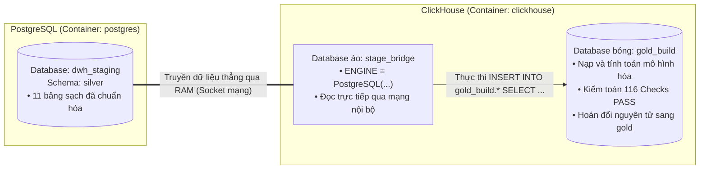
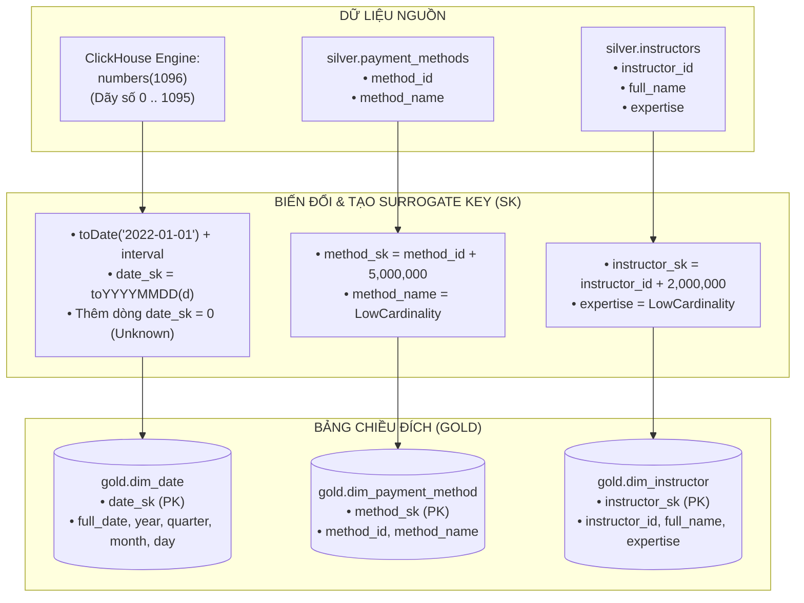
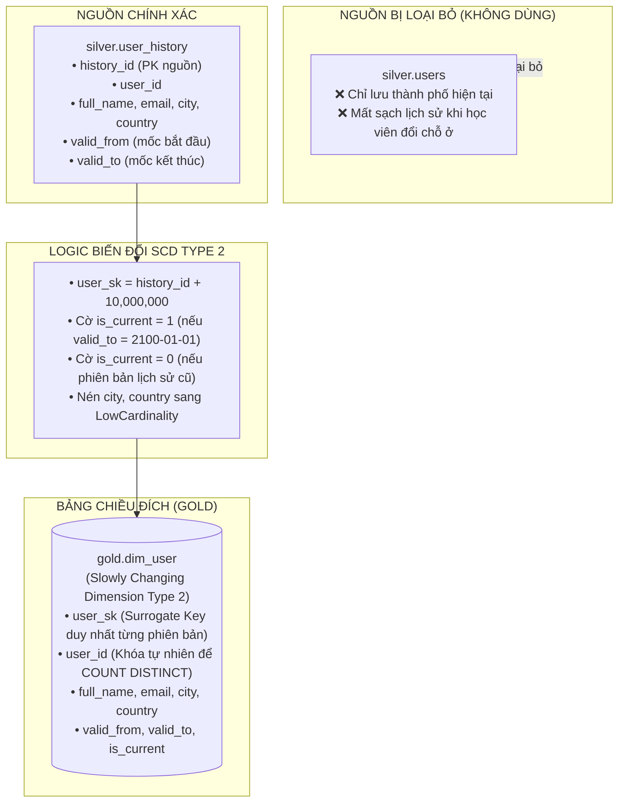
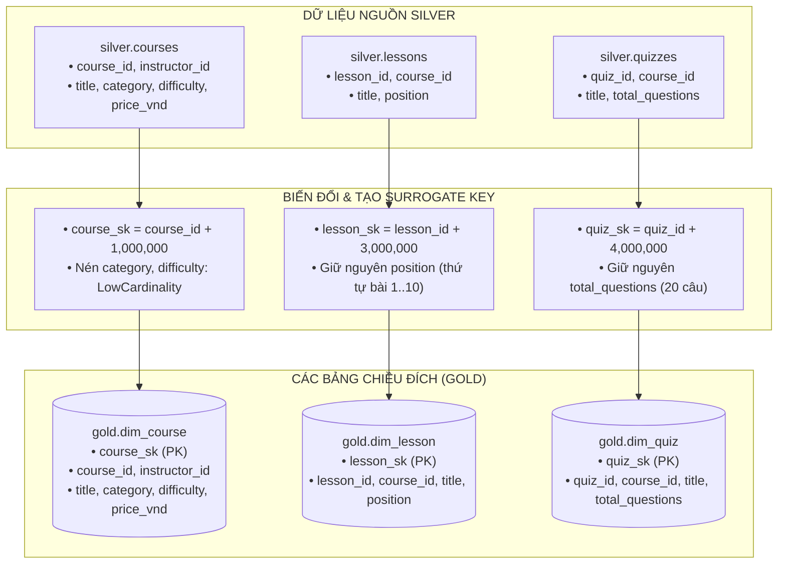
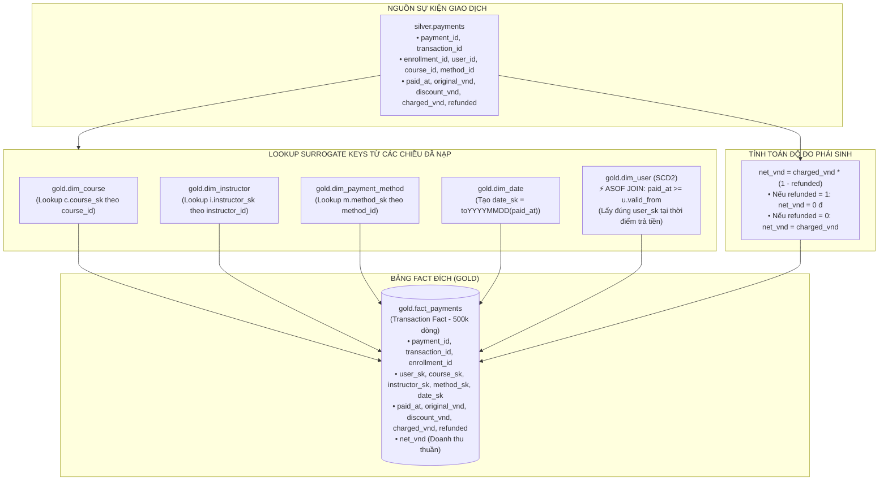
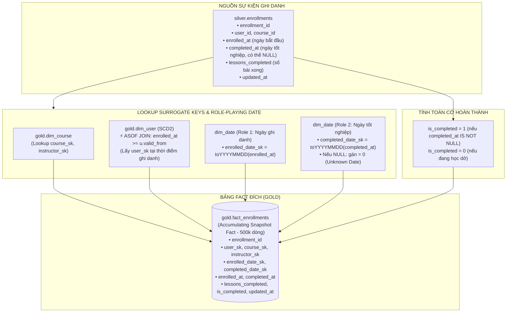
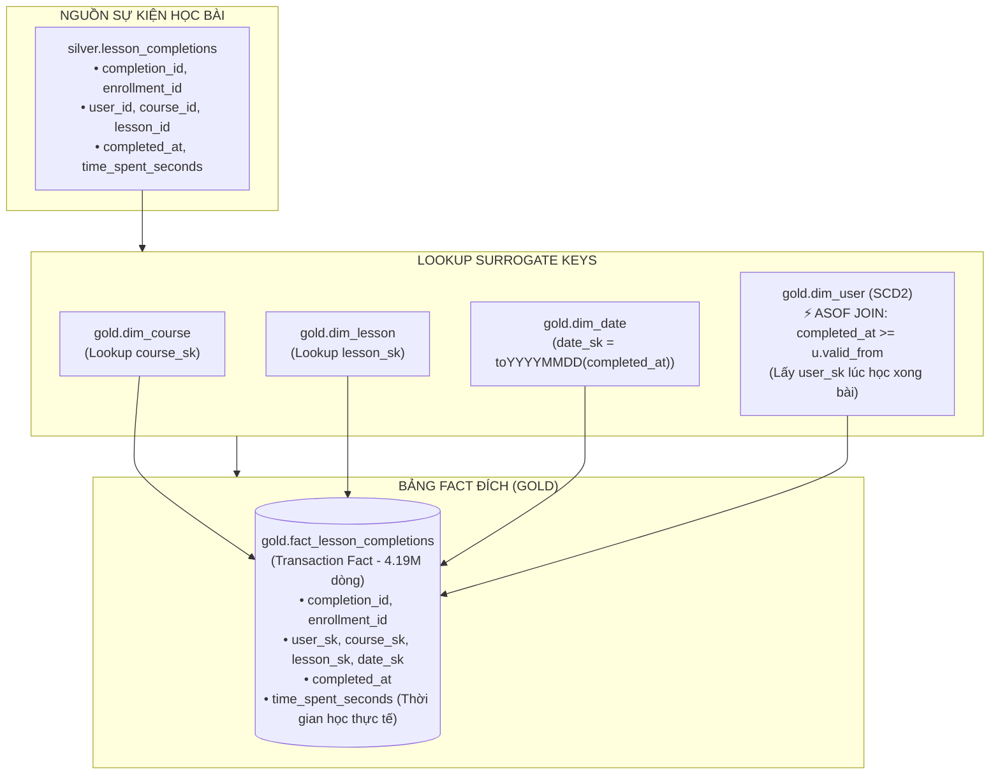
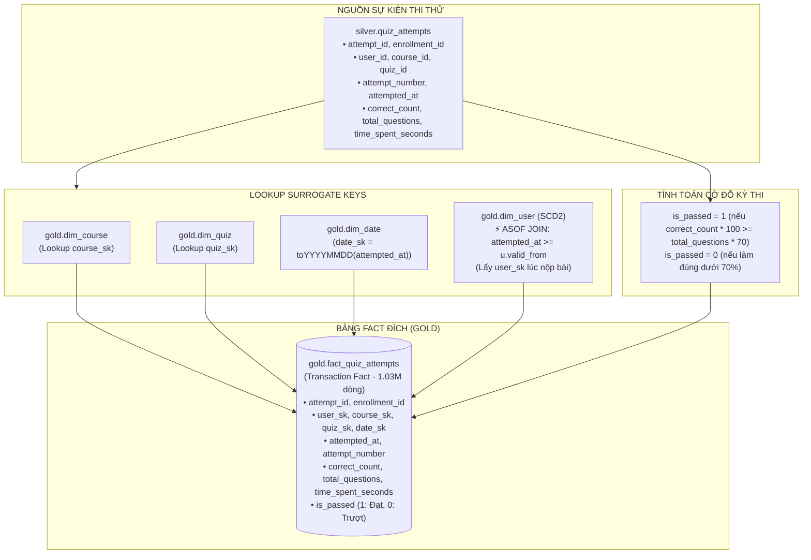
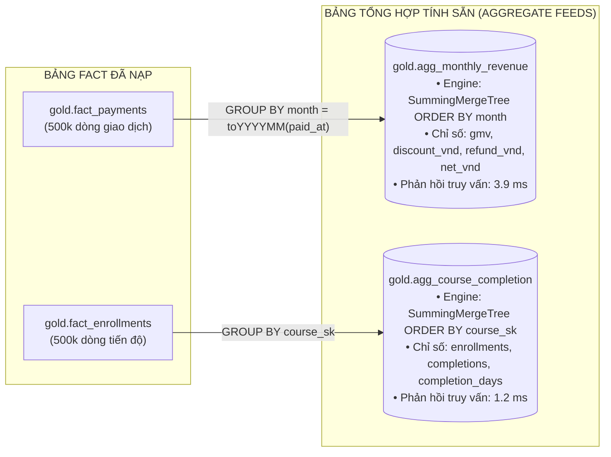

# QUY TRÌNH MÔ HÌNH HÓA VÀ BIẾN ĐỔI DỮ LIỆU TỪ SILVER SANG GOLD
## (Chi Tiết Từng Luồng Bằng Sơ Đồ Mermaid Phân Đoạn)

> **Mục tiêu tài liệu:**  
> Thay vì dùng một sơ đồ tổng thể khổng lồ gây rối mắt, tài liệu này **chia nhỏ luồng biến đổi dữ liệu từ PostgreSQL Silver sang ClickHouse Gold thành 8 sơ đồ trực quan độc lập**.  
> Mỗi sơ đồ tập trung giải quyết đúng một câu hỏi: **Bảng này lấy từ đâu ở Silver? Biến đổi công thức gì? Nối khóa nào? Và nạp vào đâu ở Gold?**

---

## 📑 MỤC LỤC CÁC SƠ ĐỒ LUỒNG

1. [Sơ đồ 0: Kiến Trúc Cầu Nối Bộ Nhớ (Zero-Copy Stage Bridge)](#1-sơ-đồ-0-kiến-trúc-cầu-nối-bộ-nhớ-zero-copy-stage-bridge)
2. [Sơ đồ 1: Luồng Các Chiều Danh Mục Độc Lập (`dim_date`, `dim_payment_method`, `dim_instructor`)](#2-sơ-đồ-1-luồng-các-chiều-danh-mục-độc-lập)
3. [Sơ đồ 2: Luồng Chiều Học Viên Bảo Toàn Lịch Sử SCD Type 2 (`dim_user`)](#3-sơ-đồ-2-luồng-chiều-học-viên-bảo-toàn-lịch-sử-scd-type-2)
4. [Sơ đồ 3: Luồng Nhóm Chiều Cấu Trúc Khóa Học (`dim_course`, `dim_lesson`, `dim_quiz`)](#4-sơ-đồ-3-luồng-nhóm-chiều-cấu-trúc-khóa-học)
5. [Sơ đồ 4: Luồng Bảng Fact Doanh Thu & Thanh Toán (`fact_payments`)](#5-sơ-đồ-4-luồng-bảng-fact-doanh-thu--thanh-toán-fact_payments)
6. [Sơ đồ 5: Luồng Bảng Fact Tiến Độ Ghi Danh & Tốt Nghiệp (`fact_enrollments`)](#6-sơ-đồ-5-luồng-bảng-fact-tiến-độ-ghi-danh--tốt-nghiệp-fact_enrollments)
7. [Sơ đồ 6: Luồng Bảng Fact Hoàn Thành Bài Giảng (`fact_lesson_completions`)](#7-sơ-đồ-6-luồng-bảng-fact-hoàn-thành-bài-giảng-fact_lesson_completions)
8. [Sơ đồ 7: Luồng Bảng Fact Kết Quả Thi Trắc Nghiệm (`fact_quiz_attempts`)](#8-sơ-đồ-7-luồng-bảng-fact-kết-quả-thi-trắc-nghiệm-fact_quiz_attempts)
9. [Sơ đồ 8: Luồng Tự Động Tổng Hợp Báo Cáo Siêu Tốc (Aggregate Feeds)](#9-sơ-đồ-8-luồng-tự-động-tổng-hợp-báo-cáo-siêu-tốc-aggregate-feeds)
10. [Bảng Ma Trận Tổng Hợp Đối Chiếu Nguồn - Đích](#10-bảng-ma-trận-tổng-hợp-đối-chiếu-nguồn---đích)

---

## 1. SƠ ĐỒ 0: KIẾN TRÚC CẦU NỐI BỘ NHỚ (ZERO-COPY STAGE BRIDGE)

Trước khi đi vào từng bảng, đây là cơ chế vật lý giúp ClickHouse đọc được dữ liệu sạch từ PostgreSQL Silver mà **không cần ghi file trung gian ra ổ đĩa**:

* **Nguyên lý:** ClickHouse tạo database ảo `stage_bridge` kết nối thẳng vào PostgreSQL. Dữ liệu từ schema `silver` được nạp thẳng vào RAM của ClickHouse với tốc độ hàng trăm nghìn dòng mỗi giây. Sau khi nạp xong, database `stage_bridge` tự động bị hủy (`DROP DATABASE`).

---

## 2. SƠ ĐỒ 1: LUỒNG CÁC CHIỀU DANH MỤC ĐỘC LẬP

Đây là nhóm 3 bảng chiều đầu tiên được nạp vì chúng **hoàn toàn độc lập**, không phụ thuộc vào bất kỳ bảng nào khác:

### 💡 Điểm cốt lõi cần nhớ:
1. **`dim_date` không lấy từ Silver:** Bảng lịch được sinh trước bằng thuật toán 1.096 ngày liên tục (2022–2024). Dòng `date_sk = 0` (`1970-01-01`) dành riêng cho các sự kiện chưa kết thúc (như khóa học chưa tốt nghiệp).
2. **Khóa thay thế (SK):**
   * Phương thức thanh toán: `method_sk = method_id + 5.000.000`.
   * Giảng viên: `instructor_sk = instructor_id + 2.000.000`.

---

## 3. SƠ ĐỒ 2: LUỒNG CHIỀU HỌC VIÊN BẢO TOÀN LỊCH SỬ SCD TYPE 2

Nhiều người hay nhầm lẫn giữa `silver.users` và `silver.user_history`. Sơ đồ này làm rõ tại sao phải lấy từ `silver.user_history`:

### 💡 Ví dụ thực tế:
Học viên 5 (Nhật Phạm) chuyển từ Đà Nẵng vào TP.HCM ngày 01/07/2023:
* **Phiên bản 1 (Đà Nẵng):** `history_id = 51` $\rightarrow$ `user_sk = 10000051`, `valid_from = 2022-01-01`, `valid_to = 2023-07-01`, `is_current = 0`.
* **Phiên bản 2 (TP.HCM):** `history_id = 52` $\rightarrow$ `user_sk = 10000052`, `valid_from = 2023-07-01`, `valid_to = 2100-01-01`, `is_current = 1`.

---

## 4. SƠ ĐỒ 3: LUỒNG NHÓM CHIỀU CẤU TRÚC KHÓA HỌC

Nhóm chiều này biểu diễn cây cấu trúc đào tạo: **Khóa học $\rightarrow$ Bài học $\rightarrow$ Đề thi trắc nghiệm**:

### 💡 Quy tắc khóa thay thế:
* Khóa học: `course_sk = course_id + 1.000.000`
* Bài học: `lesson_sk = lesson_id + 3.000.000`
* Đề thi: `quiz_sk = quiz_id + 4.000.000`

---

## 5. SƠ ĐỒ 4: LUỒNG BẢNG FACT DOANH THU & THANH TOÁN (`fact_payments`)

Đây là trung tâm tài chính của hệ thống. Bảng này đọc từng giao dịch từ `silver.payments` và **JOIN vào 4 bảng Dimension** để thay thế toàn bộ khóa nguồn thành Surrogate Keys:

---

## 6. SƠ ĐỒ 5: LUỒNG BẢNG FACT TIẾN ĐỘ GHI DANH & TỐT NGHIỆP (`fact_enrollments`)

Khác với thanh toán, ghi danh là **Accumulating Snapshot Fact** (theo dõi tiến độ tích lũy từ lúc nhập học đến khi tốt nghiệp). Bảng này sử dụng **Role-Playing Dimension** cho chiều thời gian:

---

## 7. SƠ ĐỒ 6: LUỒNG BẢNG FACT HOÀN THÀNH BÀI GIẢNG (`fact_lesson_completions`)

Đây là bảng sự kiện có quy mô lớn nhất hệ thống (**khoảng 4.2 triệu dòng**), ghi lại hành vi xem video bài học của học viên:

---

## 8. SƠ ĐỒ 7: LUỒNG BẢNG FACT KẾT QUẢ THI TRẮC NGHIỆM (`fact_quiz_attempts`)

Ghi nhận kết quả làm bài thi trắc nghiệm đánh giá năng lực (**khoảng 1.03 triệu dòng**):

---

## 9. SƠ ĐỒ 8: LUỒNG TỰ ĐỘNG TỔNG HỢP BÁO CÁO SIÊU TỐC (AGGREGATE FEEDS)

Sau khi 4 bảng Fact nạp xong, hệ thống nạp tiếp 2 bảng tổng hợp tính toán sẵn (**Aggregate Feeds**) để phục vụ báo cáo với tốc độ dưới **4 mili-giây**:

---

## 10. BẢNG MA TRẬN TỔNG HỢP ĐỐI CHIẾU NGUỒN - ĐÍCH

| STT | Đối tượng Gold | Loại bảng | Nguồn Silver chính | Các Dimension được JOIN để lấy SK | Công thức / Quy tắc biến đổi cốt lõi |
| :-: | :--- | :--- | :--- | :--- | :--- |
| **1** | `dim_date` | Chiều | *ClickHouse `numbers(1096)`* | *Không có* | Sinh 1.096 ngày lịch (2022–2024) + dòng `date_sk = 0` (Unknown). |
| **2** | `dim_user` | Chiều (SCD2)| `silver.user_history` | *Không có* | `user_sk = history_id + 10M`, gán `is_current = (valid_to = 2100-01-01)`. |
| **3** | `dim_course` | Chiều | `silver.courses` | *Không có* | `course_sk = course_id + 1M`, nén `category` & `difficulty`. |
| **4** | `dim_instructor` | Chiều | `silver.instructors` | *Không có* | `instructor_sk = instructor_id + 2M`, nén `expertise`. |
| **5** | `dim_lesson` | Chiều | `silver.lessons` | *Không có* | `lesson_sk = lesson_id + 3M`, lưu thứ tự bài `position` (1..10). |
| **6** | `dim_quiz` | Chiều | `silver.quizzes` | *Không có* | `quiz_sk = quiz_id + 4M`, lưu `total_questions` (20 câu). |
| **7** | `dim_payment_method`| Chiều | `silver.payment_methods`| *Không có* | `method_sk = method_id + 5M` (`bank_transfer`, `card`, `wallet`). |
| **8** | `fact_payments` | Sự kiện | `silver.payments` | `dim_course`, `dim_instructor`, `dim_payment_method`, `dim_user` (ASOF), `dim_date` | $\text{net\_vnd} = \text{charged\_vnd} \times (1 - \text{refunded})$. |
| **9** | `fact_enrollments` | Sự kiện | `silver.enrollments` | `dim_course`, `dim_instructor`, `dim_user` (ASOF), `dim_date` (Role 1 & 2) | Role-playing date (`completed_date_sk = 0` nếu chưa xong); cờ `is_completed`. |
| **10**| `fact_lesson_completions`| Sự kiện | `silver.lesson_completions`| `dim_course`, `dim_lesson`, `dim_user` (ASOF), `dim_date` | Lưu `time_spent_seconds` thời lượng học thực tế. |
| **11**| `fact_quiz_attempts` | Sự kiện | `silver.quiz_attempts` | `dim_course`, `dim_quiz`, `dim_user` (ASOF), `dim_date` | Gán `is_passed = 1` nếu điểm $\ge 70\%$ ($\ge 14/20$ câu đúng). |
| **12**| `agg_monthly_revenue`| Tổng hợp | `gold.fact_payments` | *Không có* | `SummingMergeTree` gom nhóm theo tháng phát sinh doanh thu. |
| **13**| `agg_course_completion`| Tổng hợp | `gold.fact_enrollments` | *Không có* | `SummingMergeTree` gom nhóm theo khóa học để tính tỷ lệ hoàn thành. |
