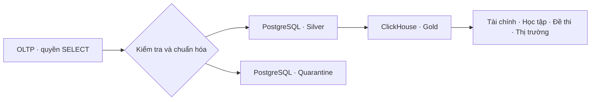

# Tóm tắt kho dữ liệu học trực tuyến

## 1. Từ một lượt ghi danh đến báo cáo

Một học viên đăng ký, đóng học phí, hoàn thành bài giảng và làm quiz. Bốn hành động này có bốn mức chi tiết riêng. Nếu nối thẳng mỗi khoản thanh toán với từng bài học, một khoản tiền sẽ bị cộng nhiều lần. Kho dữ liệu giữ bốn bảng sự kiện riêng, dùng chung ngày, học viên và khóa học để đối chiếu sau khi đã tổng hợp đúng mức.

| Sự kiện | Một dòng đại diện cho | Câu hỏi |
|---|---|---|
| Thanh toán | Một giao dịch | Tiền thực thu và tỷ lệ hoàn tiền là bao nhiêu? |
| Ghi danh | Trạng thái mới nhất của một lượt ghi danh | Học viên dừng ở bước nào? |
| Bài giảng | Một bài đã hoàn thành của một lượt ghi danh | Mức độ tham gia thay đổi ra sao? |
| Quiz | Một lượt thử | Đề nào có tỷ lệ trượt cao? |

Học viên giả lập số 5 chuyển từ Đà Nẵng sang TP.HCM ngày 01/07/2023. Kho giữ hai phiên bản địa chỉ. Khi ghép giao dịch, hệ thống chọn phiên bản có hiệu lực tại ngày giao dịch, nên số liệu trước khi chuyển vẫn thuộc Đà Nẵng. Khi tiến độ thay đổi, bản ghi ghi danh mới mang thời điểm cập nhật để ClickHouse chọn đúng phiên bản.

## 2. Trải nghiệm và bằng chứng

| Mục tiêu | Thao tác | Cột hoặc bằng chứng cần xem |
|---|---|---|
| Tách nguồn tác nghiệp | Kết nối bằng role ETL | Giao dịch chỉ đọc và quyền UPDATE bị thiếu trong `ket-qua-mau/verification_v2.json` |
| Đối soát tài chính | Chạy `cli.py validate` | So sánh tổng tiền PostgreSQL Silver với Gold và bảng tổng hợp tháng |
| Xem lịch sử chuyển vùng | Chạy bộ unittest | Kiểm tra đúng phiên bản trước, đúng và sau ranh giới SCD2 |
| Giữ lại dữ liệu sai | Cập nhật một email giả thành giá trị sai, nạp, rồi khôi phục email | `ERR_INVALID_EMAIL` và email gốc trong Quarantine |
| Nạp tăng dần | Gửi thêm 10.000 lượt thi đến muộn và chạy incremental hai lần | Số dòng quiz tăng đúng 10.000, lần sau đọc 0 dòng và fingerprint không đổi |
| So sánh hai hệ quản trị | Đối chiếu SHA256 từng bảng rồi chạy bảy truy vấn | `ket-qua-mau/benchmark/results.md` và metadata đối chiếu |
| Khai thác | Mở [Streamlit](http://localhost:8502) | Bốn góc nhìn nghiệp vụ, khu cách ly và nút nạp tăng dần |

Lần full load có đo bộ nhớ xử lý 5.732.103 dòng trong 158,613 giây. Tiến trình Python đạt đỉnh 187,14 MiB. Sau các lần chạy thử, kho có 5.752.103 dòng nguồn hợp lệ, trong đó có 1.030.000 lượt thi. Dữ liệu tăng thêm do ba lô thử, mỗi lô 10.000 lượt thi.

Ở kịch bản cuối, ETL chỉ đọc 10.002 dòng từ OLTP gồm 10.000 lượt thi, một cập nhật ghi danh và một email lỗi. ClickHouse chèn đúng 10.000 lượt thi, cập nhật phiên bản ghi danh và giữ nguyên các partition thanh toán, bài học. Lần nạp này mất 10,780 giây gồm kiểm tra và công bố Gold. Lần chạy rỗng mất 0,798 giây. Cả 11 fingerprint giữ nguyên sau khi khôi phục email và chạy lại. Xem [log nghiệm thu](../ket-qua-mau/verification_v2.json).

Lỗi timestamp ở lần thử trước xảy ra trong bản Gold tạm. Hệ thống giữ mốc phân thủy, sau đó đọc lại lô và hoàn tất sau khi đổi bước lọc delta sang PostgreSQL. Kiểm tra cuối đạt 116/116 chỉ tiêu và 10 unittest, trong đó có kiểm tra ranh giới SCD2 và sai kiểu số tiền. Xem [kiểm toán chất lượng](../ket-qua-mau/quality.json).

AppTest dựng sáu tab và ba biểu đồ trong 913,56 ms, đồng thời chạy thành công hai mục phân tích mở rộng. Truy vấn đọc bảng tổng hợp tháng có trung vị 3,915 ms qua 11 lượt đo từ container dashboard. Phép đo AppTest không tính thời gian tải trình duyệt. Xem [kết quả kiểm tra portal](../ket-qua-mau/portal_v2.json).

Benchmark đối chiếu SHA256 trên cả 11 bảng rồi chạy bảy truy vấn trên cùng dữ liệu. Cả bảy truy vấn trả kết quả khớp. Bảng dưới lấy trung vị của ba lần đo sau hai lượt khởi động.

| Query | PostgreSQL median ms | ClickHouse median ms | PG / CH |
|---|---:|---:|---:|
| Q1_monthly_revenue | 51.766 | 13.733 | 3.77x |
| Q2_slice_category | 11.89 | 9.541 | 1.246x |
| Q3_four_dimensions | 127.463 | 52.113 | 2.446x |
| Q4_window_running_total | 50.697 | 14.079 | 3.601x |
| Q5_cube | 357.057 | 36.852 | 9.689x |
| Q6_drill_across | 76.775 | 17.77 | 4.32x |
| Q7_learning_full_scan | 6533.243 | 168.621 | 38.745x |

Mức chênh lệch quan sát được từ 1,25× đến 38,75×. Truy vấn cắt lát theo danh mục đạt 1,25×, dưới mốc 1,7× trong kế hoạch. Phép đo dùng Docker cục bộ với ngân sách RAM khác nhau cho hai hệ quản trị. Xem [số đo chi tiết](../ket-qua-mau/benchmark/results.md).

## 3. Giới hạn

Mốc phân thủy dựa vào thời điểm cập nhật và khóa nguồn. Các giao dịch giữ mở lâu rồi commit lệch thứ tự, hoặc xóa vật lý, cần cơ chế CDC để theo dõi đầy đủ. Công bố Gold đổi bảng theo từng bước. Portal và CLI chờ manifest thành công, còn truy vấn SQL trực tiếp cần tránh cửa sổ công bố. Giới hạn luồng và tràn đĩa giúp kiểm soát bộ nhớ. Mục tiêu 1–2 giây cho lần nạp có 10.000 sự kiện chưa đạt. Cần bài đo riêng cho nhiều người dùng đồng thời và quy mô 50–100 triệu dòng.

Báo cáo mượn cách đi từ tình huống, thao tác đến bằng chứng từ tài liệu mẫu PTIT trong ZIP. Các con số của dự án được lấy từ log nghiệm thu của kho dữ liệu giả lập.

